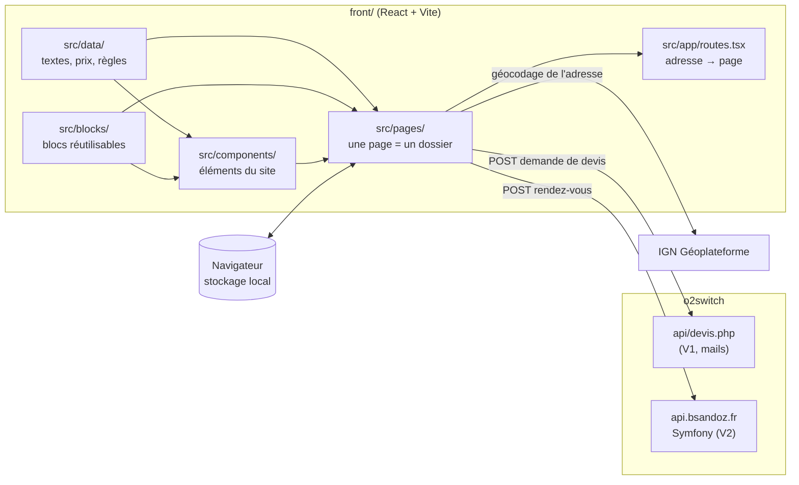

# Vue d'ensemble

## À quoi ça sert
Comprendre en une page où se trouve chaque chose et dans quel sens circulent les données.

## Schéma

## Le chemin d'une page
1. L'adresse (ex. `/tarifs`) est déclarée dans `src/data/pages.ts` (adresse, titre d'onglet, description, titre principal).
2. `src/app/routes.tsx` associe chaque adresse à sa page (`builtPages`), sous la mise en page commune `components/Layout`.
3. La page (`src/pages/Tarifs/`) assemble des **blocs** (`src/blocks/`) et des **composants** (`src/components/`), avec les textes et prix de `src/data/`.

## Les règles qui tiennent l'ensemble
- **Aucun texte ni prix en dur** dans un composant : tout vient de `src/data/`.
- **Un bloc ne connaît pas bsandoz.fr** : il reçoit tout par ses paramètres, il peut donc servir sur un autre site.
- **La logique est en fonctions pures** (`data/calculs.ts`, `pages/*/reservation.ts`, `pages/Devis/demande.ts`…) : testables sans écran.
- **CSS** : variables dans `src/styles/tokens.css`, un `*.module.css` par bloc ou composant.

## Tests
| Type | Outil | Où |
| --- | --- | --- |
| unitaires | Vitest + Testing Library | à côté du code (`*.test.ts(x)`) |
| fonctionnels | Vitest + Testing Library (clics, clavier, réseau simulé) | `src/pages/*/*.test.tsx`, `src/app/*.test.tsx` |
| API | PHPUnit (dans Docker) | `api/tests/` |
| architecture | PHPUnit | `api/tests/Architecture/` |

Lancer : `cd front && npm run test` · `cd api && docker run --rm -v "$PWD:/app" -w /app -e APP_CACHE_DIR=/tmp/cache composer:2 php bin/phpunit`
