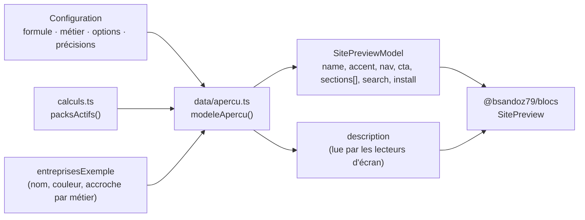

# Aperçu en direct

## À quoi ça sert
Montrer au visiteur, pendant qu'il compose, à quoi ressemblera son site : nom et couleur selon son métier, navigation, réservation, boutique, appli…

## Schéma


## Chemin
1. `modeleApercu(config)` choisit l'entreprise d'exemple du métier (« Atelier Brillance » pour artisan…).
2. Chaque option choisie **ou offerte** ajoute sa section : calculateur, réservation (+ acompte), table, boutique, click & collect, galerie, avant/après, avis, contact.
3. `SitePreview` dessine le tout ; le dessin est caché aux lecteurs d'écran, qui lisent la description.

## Comment l'appeler
```tsx
import { SitePreview } from '@bsandoz79/blocs';
import { modeleApercu } from '../data/apercu';

const { modele, description } = modeleApercu(config);
<SitePreview label="Aperçu de votre futur site" description={description} model={modele} emptyMessage="Choisissez un type de site." />
```
Utilisé par `/composer` (colonne de droite) et les pages métier (exemple fictif).

## Réutilisable ?
- `SitePreview` : **oui**, il ne connaît aucun métier ; il dessine n'importe quel modèle (sections listées dans son README).
- `modeleApercu` : propre aux options de ce site.

## Tests
- **unitaires** : `packages/blocs/src/SitePreview/SitePreview.test.tsx` (chaque type de section, description, message vide), `data/apercu.test.ts` (sections selon les options, options offertes, précisions, métier par défaut).
- **fonctionnels** : section « aperçu en direct » de `Composer.test.tsx`.
