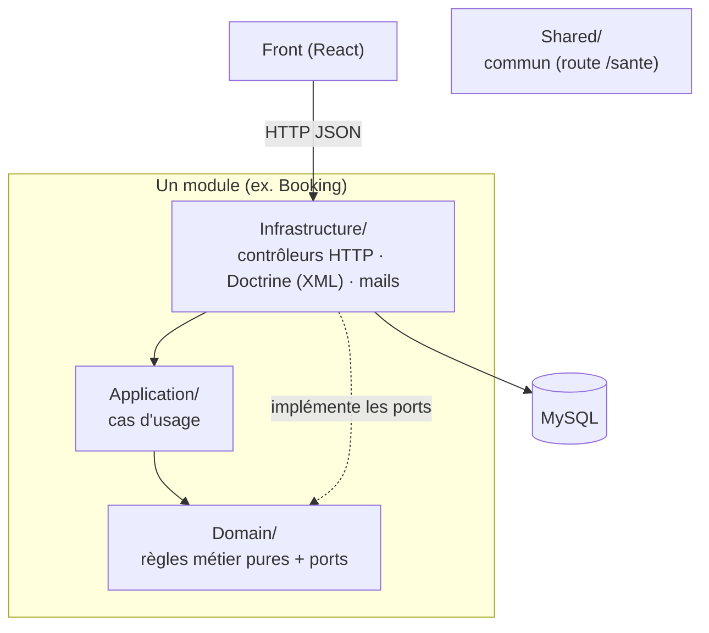

# API (Symfony)

## À quoi ça sert
Le serveur de la V2 et de la V3 : rendez-vous, demandes et devis, puis espace client. Hébergement prévu sur `api.bsandoz.fr`.

## Schéma : monolithe modulaire, cœur hexagonal

Modules : `Shared`, `Auth` (V3), `Prospect` (demandes, devis), `Booking` (rendez-vous), `Notification` (mails, rappels, .ics).

## Chemin d'une requête
`public/index.php` → noyau Symfony → route (attribut `#[Route]` sur un contrôleur de `Infrastructure/Http`) → cas d'usage (`Application`) → domaine (`Domain`) → dépôt Doctrine (`Infrastructure/Doctrine`) → réponse JSON.

## Comment l'appeler
| Méthode | Adresse | Réponse |
| --- | --- | --- |
| GET | `/sante` | `200 {"statut":"ok"}` |
| POST | `/rendez-vous` | à venir (module Booking) |

## Règle vérifiée automatiquement
Un fichier de `Domain/` n'importe ni Symfony, ni Doctrine, ni une `Infrastructure`, ni le domaine d'un autre module (`tests/Architecture/DomaineIndependantTest.php`).

## Réutilisable ?
Chaque module est autonome : Booking pourra servir les rendez-vous d'autres sites (à décider avec la proposition « A »).

## Tests
- **fonctionnels** : `tests/Shared/SanteTest.php`.
- **architecture** : `tests/Architecture/DomaineIndependantTest.php`.
- **CI** : job `api` (PHP 8.3, MySQL 8.0 de test, conteneur, YAML, Doctrine, PHPUnit).

Lancer : `cd api && docker run --rm -v "$PWD:/app" -w /app -e APP_CACHE_DIR=/tmp/cache composer:2 php bin/phpunit`. Détails : `docs/api.md`.
