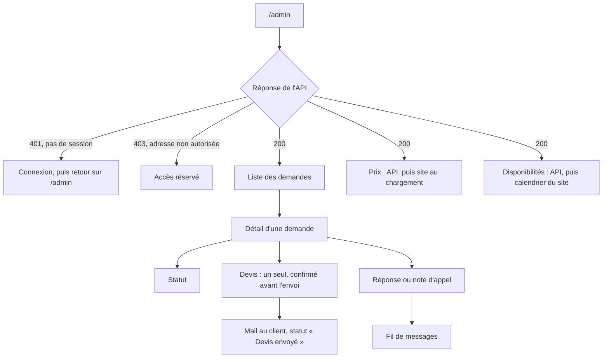
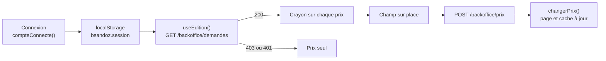

# Back-office

## À quoi ça sert
L'écran de travail de Baptiste, à l'adresse `/admin` : suivre les demandes, établir et envoyer les devis, répondre aux clients, noter les appels, modifier les prix, régler les disponibilités.

## Schéma

## Chemin
| Élément | Fichier |
| --- | --- |
| Pages | `front/src/pages/Admin/` : `Admin.tsx`, `DemandesAdmin.tsx`, `DetailDemande.tsx`, `FormulaireDevis.tsx` |
| Appels à l'API | `front/src/pages/Admin/api.ts` ; textes : `front/src/data/admin.ts` |
| Droits | `api/src/BackOffice/GardeBackOffice.php` (`BACKOFFICE_EMAILS`) |
| Points d'entrée | `api/src/BackOffice/DemandesController.php` |
| Prix | `api/src/BackOffice/PrixController.php`, `api/src/Catalogue/`, `front/src/pages/Admin/PrixAdmin.tsx`, `front/src/data/prixEnLigne.ts` |
| Disponibilités | `api/src/BackOffice/DisponibilitesController.php`, `api/src/Booking/Domain/Disponibilites.php`, `front/src/pages/Admin/DisponibilitesAdmin.tsx` |
| Première entrée | `api/src/BackOffice/OuvrirAccesCommand.php` |
| Règles du statut | `api/src/Prospect/Application/ChangerStatut.php` |

## Comment l'appeler
**Ouvrir son accès, une seule fois :**
1. `BACKOFFICE_EMAILS=contact@bsandoz.fr` dans `.env.local` (plusieurs adresses : séparées par des virgules ; vide : personne n'entre).
2. `php bin/console backoffice:ouvrir-acces contact@bsandoz.fr "Baptiste Sandoz"` : le lien d'activation part par mail.
3. Choisir un mot de passe depuis l'espace client, puis aller sur `/admin`.

| Méthode | Adresse | Corps | Réponses |
| --- | --- | --- | --- |
| GET | `/backoffice/demandes` | — | 200 `{ demandes }` · 401 · 403 |
| GET | `/backoffice/demandes/{id}` | — | 200 `{ demande }` · 401 · 403 · 404 |
| POST | `/backoffice/demandes/{id}/statut` | `{ statut }` | 200 · 400 · 409 |
| POST | `/backoffice/demandes/{id}/devis` | `{ lignes: [{ libelle, prix }] }` | 200 · 400 · 409 |
| POST | `/backoffice/demandes/{id}/messages` | `{ corps, note }` | 200 · 400 |
| POST | `/backoffice/prix` | `{ prix: { "formule.vitrine": 120 } }` (remplace tous les prix modifiés) | 200 · 400 |
| GET | `/prix` | — (public) | 200 `{ prix }` |
| POST | `/backoffice/disponibilites` | `{ joursTravailles, creneaux, joursFermes }` | 200 · 400 |
| GET | `/rendez-vous/disponibilites` | — (public) | 200 |

## Règles
- **Le statut reste vrai pour le client** : pas de « Devis envoyé » sans devis ; pas d'« Accepté », « En cours » ni « Livré » tant que le client n'a pas accepté depuis son espace ; une acceptation enregistrée ne s'efface pas.
- **Devis** : un seul par demande, prix en euros entiers, confirmation avant l'envoi. Il ne se modifie plus une fois envoyé.
- **Prix** : le code reste la référence. Seuls les prix modifiés sont stockés ; remettre le prix d'origine annule la modification. Si l'API est lente ou en panne, le site affiche les prix du code ou les derniers connus, sans attendre plus de 800 ms. Un devis déjà envoyé ne change pas.
- **Disponibilités** : valeurs de `booking.yaml` tant que rien n'est réglé. L'API a le dernier mot à la réservation. Les rendez-vous déjà pris ne sont pas annulés.
- **Sécurité** : session de l'espace client + adresse autorisée, vérifiées par l'API à chaque requête. Le front ne décide de rien. Corps JSON obligatoire pour modifier. `/admin` n'est ni indexée ni dans le sitemap.

## Réutilisable ?
En partie : `api/src/BackOffice/` et `pages/Admin/` s'appuient sur Auth, Prospect, Booking et Catalogue. Voir `docs/mise-en-place/espace-client.md`.

## Tests
- **fonctionnels** : `api/tests/BackOffice/DemandesBackOfficeTest.php` (HTTP + MySQL : refus 401 et 403 sur toutes les adresses, 415, statut, devis jusqu'à la livraison, messages, ouverture d'accès), `front/src/pages/Admin/Admin.test.tsx`.
- **prix** : `PrixBackOfficeTest.php`, `CatalogueTest.php`, `prixEnLigne.test.ts`, `PrixAdmin.test.tsx`.
- **disponibilités** : `DisponibilitesBackOfficeTest.php`, `DisponibilitesAdmin.test.tsx`, `reservation.test.ts`.
- **unitaires** : `adresseDeRetour` (`MonEspace.test.tsx`) : pas de retour vers un site extérieur après la connexion.

## Écran des disponibilités
Tout se règle d'un clic (`pages/Admin/DisponibilitesAdmin.tsx`) :
- **jours travaillés** : sept boutons Lun à Dim ;
- **heures de rendez-vous** : une grille de 7 h à 20 h, par demi-heure, groupée en matin, après-midi et soir. Une heure déjà enregistrée hors de la grille reste affichée ;
- **jours fermés** : un clic dans le calendrier ferme le jour, un second le rouvre (bloc `Calendar`, options `isMarked` et `markedLabel`). Les jours fermés sont aussi listés, avec une croix pour les rouvrir.

## Édition directe sur les pages (crayon)
Un compte du back-office modifie les prix directement sur le site, sans passer par `/admin`.

- **Qui voit les crayons** (`app/edition.ts`, `useEdition`) : une connexion est notée dans le navigateur (`bsandoz.session`, par `compteConnecte` et `seDeconnecter`). Si elle existe, le site appelle `/backoffice/demandes` : 200 affiche les crayons, 403 non, 401 efface la note. Un visiteur sans session ne déclenche aucun appel. La note ne donne aucun droit : c'est l'API qui refuse tout enregistrement à un compte non autorisé.
- **Le composant** (`components/PrixModifiable`) : `<PrixModifiable cle="formule.vitrine" nom="Vitrine" montant={() => formule.prix}>{() => 
…
}</PrixModifiable>`. Crayon, champ, Entrée ou « Enregistrer », Échap ou « Annuler ».
- **L'enregistrement** : `POST /backoffice/prix` avec tous les prix qui diffèrent du code (`prixModifiesActuels`), puis `changerPrix` met à jour la page et le cache du navigateur.
- **Où** : les trois formules (accueil et Tarifs) et la page supplémentaire.
- **Limites actuelles** : les textes calculés une fois au chargement (hero, FAQ, CGV) suivent au rechargement suivant. Les prix écrits dans le code (heure, suivi mensuel, SEO seul) et les options du simulateur n'ont pas de crayon. Textes et images ne sont pas encore modifiables : il faudra les stocker dans l'API.

Tests : `PrixModifiable.test.tsx` (visiteur sans appel, 403, 401, enregistrement, retour au prix du code, annulation, montant invalide, échec de l'API).
