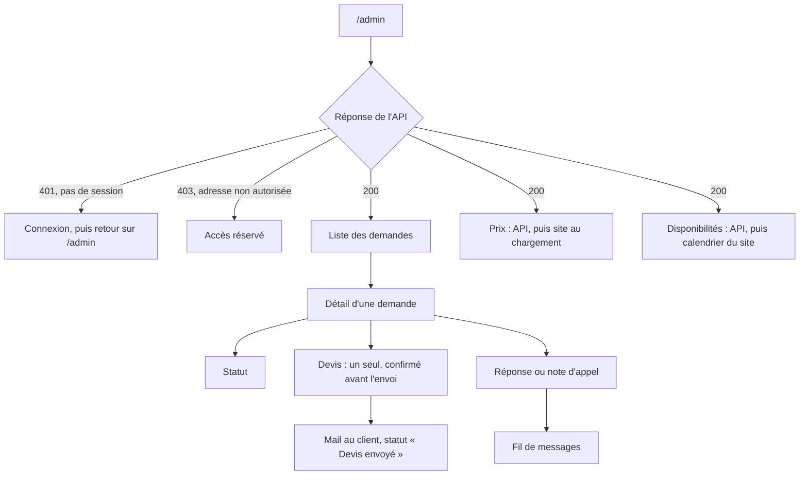
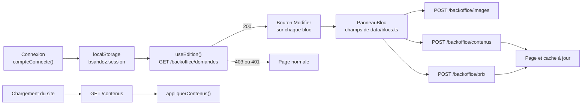

# Back-office

## À quoi ça sert
L'écran de travail de Baptiste, à l'adresse `/admin` : suivre les demandes, établir et envoyer les devis, répondre aux clients, noter les appels, modifier les prix, régler les disponibilités.

## Schéma

## Chemin
| Élément | Fichier |
| --- | --- |
| Pages | `front/src/pages/Admin/` : `Admin.tsx`, `DemandesAdmin.tsx`, `DetailDemande.tsx`, `FormulaireDevis.tsx` |
| Appels à l'API | `front/src/pages/Admin/api.ts` ; textes : `front/src/data/admin.ts` |
| Droits | `api/src/BackOffice/GardeBackOffice.php` (`BACKOFFICE_EMAILS`) |
| Points d'entrée | `api/src/BackOffice/DemandesController.php` |
| Prix | `api/src/BackOffice/PrixController.php`, `api/src/Catalogue/`, `front/src/pages/Admin/PrixAdmin.tsx`, `front/src/data/prixEnLigne.ts` |
| Disponibilités | `api/src/BackOffice/DisponibilitesController.php`, `api/src/Booking/Domain/Disponibilites.php`, `front/src/pages/Admin/DisponibilitesAdmin.tsx` |
| Première entrée | `api/src/BackOffice/OuvrirAccesCommand.php` |
| Règles du statut | `api/src/Prospect/Application/ChangerStatut.php` |

## Comment l'appeler
**Ouvrir son accès, une seule fois :**
1. `BACKOFFICE_EMAILS=contact@bsandoz.fr` dans `.env.local` (plusieurs adresses : séparées par des virgules ; vide : personne n'entre).
2. `php bin/console backoffice:ouvrir-acces contact@bsandoz.fr "Baptiste Sandoz"` : le lien d'activation part par mail.
3. Choisir un mot de passe depuis l'espace client, puis aller sur `/admin`.

| Méthode | Adresse | Corps | Réponses |
| --- | --- | --- | --- |
| GET | `/backoffice/demandes` | — | 200 `{ demandes }` · 401 · 403 |
| GET | `/backoffice/demandes/{id}` | — | 200 `{ demande }` · 401 · 403 · 404 |
| POST | `/backoffice/demandes/{id}/statut` | `{ statut }` | 200 · 400 · 409 |
| POST | `/backoffice/demandes/{id}/devis` | `{ lignes: [{ libelle, prix }] }` | 200 · 400 · 409 |
| POST | `/backoffice/demandes/{id}/messages` | `{ corps, note }` | 200 · 400 |
| POST | `/backoffice/prix` | `{ prix: { "formule.vitrine": 120 } }` (remplace tous les prix modifiés) | 200 · 400 |
| GET | `/prix` | — (public) | 200 `{ prix }` |
| POST | `/backoffice/disponibilites` | `{ joursTravailles, creneaux, joursFermes }` | 200 · 400 |
| GET | `/rendez-vous/disponibilites` | — (public) | 200 |

## Règles
- **Le statut reste vrai pour le client** : pas de « Devis envoyé » sans devis ; pas d'« Accepté », « En cours » ni « Livré » tant que le client n'a pas accepté depuis son espace ; une acceptation enregistrée ne s'efface pas.
- **Devis** : un seul par demande, prix en euros entiers, confirmation avant l'envoi. Il ne se modifie plus une fois envoyé.
- **Prix** : le code reste la référence. Seuls les prix modifiés sont stockés ; remettre le prix d'origine annule la modification. Si l'API est lente ou en panne, le site affiche les prix du code ou les derniers connus, sans attendre plus de 800 ms. Un devis déjà envoyé ne change pas.
- **Disponibilités** : valeurs de `booking.yaml` tant que rien n'est réglé. L'API a le dernier mot à la réservation. Les rendez-vous déjà pris ne sont pas annulés.
- **Sécurité** : session de l'espace client + adresse autorisée, vérifiées par l'API à chaque requête. Le front ne décide de rien. Corps JSON obligatoire pour modifier. `/admin` n'est ni indexée ni dans le sitemap.

## Réutilisable ?
En partie : `api/src/BackOffice/` et `pages/Admin/` s'appuient sur Auth, Prospect, Booking et Catalogue. Voir `docs/mise-en-place/espace-client.md`.

## Tests
- **fonctionnels** : `api/tests/BackOffice/DemandesBackOfficeTest.php` (HTTP + MySQL : refus 401 et 403 sur toutes les adresses, 415, statut, devis jusqu'à la livraison, messages, ouverture d'accès), `front/src/pages/Admin/Admin.test.tsx`.
- **prix** : `PrixBackOfficeTest.php`, `CatalogueTest.php`, `prixEnLigne.test.ts`, `PrixAdmin.test.tsx`.
- **disponibilités** : `DisponibilitesBackOfficeTest.php`, `DisponibilitesAdmin.test.tsx`, `reservation.test.ts`.
- **unitaires** : `adresseDeRetour` (`MonEspace.test.tsx`) : pas de retour vers un site extérieur après la connexion.

## Écran des disponibilités
Tout se règle d'un clic (`pages/Admin/DisponibilitesAdmin.tsx`) :
- **jours travaillés** : sept boutons Lun à Dim ;
- **heures de rendez-vous** : une grille de 7 h à 20 h, par demi-heure, groupée en matin, après-midi et soir. Une heure déjà enregistrée hors de la grille reste affichée ;
- **jours fermés** : un clic dans le calendrier ferme le jour, un second le rouvre (bloc `Calendar`, options `isMarked` et `markedLabel`). Les jours fermés sont aussi listés, avec une croix pour les rouvrir.

## Édition directe sur les pages (blocs)
Un compte du back-office modifie le site directement sur les pages, bloc par bloc, sans passer par `/admin`. Tous les blocs de l'accueil et les formules de la page Tarifs sont concernés.

- **Qui voit les boutons** (`app/edition.ts`, `useEdition`) : une connexion est notée dans le navigateur (`bsandoz.session`, par `compteConnecte` et `seDeconnecter`). Si elle existe, le site appelle `/backoffice/demandes` : 200 affiche les boutons, 403 non, 401 efface la note. Un visiteur sans session ne déclenche aucun appel. La note ne donne aucun droit : c'est l'API qui refuse tout enregistrement à un compte non autorisé.
- **Le registre** (`data/blocs.ts`) : pour chaque bloc, tout ce qu'il contient (`texte`, `long`, `image`, `prix`). Chaque champ pointe vers la donnée que la page affiche. Ajouter un champ ou un bloc se fait ici.
- **Sur la page** (`components/BlocModifiable`) : `<BlocModifiable id="accueil.hero"><Hero /></BlocModifiable>`. Pour un visiteur, aucun élément n'est ajouté à la page. Pour un compte autorisé, un bouton « Modifier » ouvre le panneau (`PanneauBloc`, chargé seulement à ce moment-là).
- **Enregistrer** : `POST /backoffice/contenus` envoie seulement ce qui a changé (`null` si on revient au texte du code) et `POST /backoffice/prix` les prix. La page et le cache du navigateur sont mis à jour sur place.
- **Images** (`app/image.ts`) : réduites à 1 600 px et converties en WebP dans le navigateur, envoyées en JSON à `POST /backoffice/images`, écrites dans `public/medias/` de l'API. Le serveur lit le vrai type du fichier et tire le nom au hasard.
- **Au chargement** (`main.tsx`) : `chargerContenus` (`data/contenusEnLigne.ts`) demande `/contenus`, avec un cache de 5 minutes et 800 ms d'attente au plus, puis `appliquerContenus` remplace les textes. Si l'API ne répond pas, le site affiche les textes de son code.
- **Du texte brut** : React l'affiche sans jamais l'interpréter comme du HTML.
- **Limites actuelles** : les autres pages (métiers, réalisations, À propos…) n'ont pas encore de blocs. Un texte qui contient un prix (« à partir de 99 € » en haut de page) reste figé une fois modifié à la main. L'heure, le suivi mensuel et le SEO seul restent écrits dans le code. Les images remplacées restent sur le serveur.

Tests : `BlocModifiable.test.tsx` (visiteur sans appel, 403, 401, texte et prix enregistrés d'un coup, retour au texte du code, image, annulation, prix invalide, échec de l'API, registre lisible) ; côté API, `tests/Contenu/ContenuTest.php` et `tests/BackOffice/ContenusBackOfficeTest.php`.

## Planning et statistiques
L'onglet **Planning**, ouvert par défaut dans `/admin` (`pages/Admin/PlanningAdmin.tsx`), montre :
- **les chiffres** (`statistiques.ts`) : RDV à venir sur 7 jours, RDV du mois, taux d'occupation de la semaine affichée, annulés du mois, demandes à traiter, devis acceptés. Tous sont calculés sur les vraies données. Sans place offerte, l'occupation affiche « – » ;
- **la semaine** : les rendez-vous placés à leur heure, navigation semaine par semaine, jours fermés grisés. Sur téléphone, une liste remplace la grille ;
- **le détail** au clic : téléphone et e-mail cliquables, adresse, frais, message ;
- **l'annulation par le professionnel** : il écrit ses disponibilités, obligatoires. Le client reçoit un mail d'excuses avec ces disponibilités, un lien pour reprendre un créneau et une adresse de réponse. Le créneau redevient libre.

API : `GET /backoffice/rendez-vous?du=AAAA-MM-JJ&au=AAAA-MM-JJ` (400 jours au plus, jamais le jeton) et `POST /backoffice/rendez-vous/{id}/annuler` avec `{ message, lien }`.

Tests : `PlanningAdmin.test.tsx` et `tests/BackOffice/PlanningBackOfficeTest.php`.
