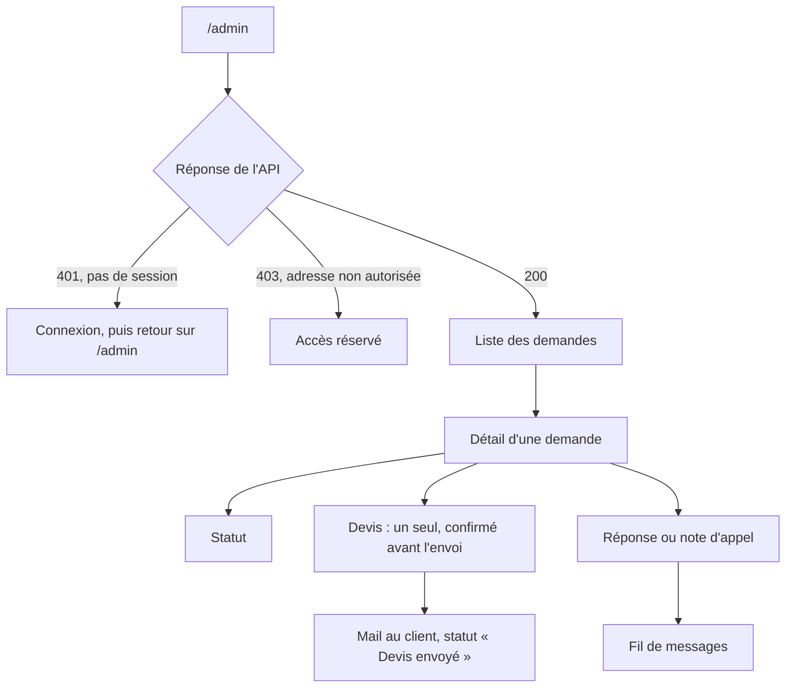

# Back-office

## À quoi ça sert
L'écran de travail de Baptiste, à l'adresse `/admin` : suivre les demandes, établir et envoyer les devis, répondre aux clients, noter les appels.

## Schéma

## Chemin
| Élément | Fichier |
| --- | --- |
| Pages | `front/src/pages/Admin/` : `Admin.tsx`, `DemandesAdmin.tsx`, `DetailDemande.tsx`, `FormulaireDevis.tsx` |
| Appels à l'API | `front/src/pages/Admin/api.ts` ; textes : `front/src/data/admin.ts` |
| Droits | `api/src/BackOffice/GardeBackOffice.php` (`BACKOFFICE_EMAILS`) |
| Points d'entrée | `api/src/BackOffice/DemandesController.php` |
| Première entrée | `api/src/BackOffice/OuvrirAccesCommand.php` |
| Règles du statut | `api/src/Prospect/Application/ChangerStatut.php` |

## Comment l'appeler
**Ouvrir son accès, une seule fois :**
1. `BACKOFFICE_EMAILS=contact@bsandoz.fr` dans `.env.local` (plusieurs adresses : séparées par des virgules ; vide : personne n'entre).
2. `php bin/console backoffice:ouvrir-acces contact@bsandoz.fr "Baptiste Sandoz"` : le lien d'activation part par mail.
3. Choisir un mot de passe depuis l'espace client, puis aller sur `/admin`.

| Méthode | Adresse | Corps | Réponses |
| --- | --- | --- | --- |
| GET | `/backoffice/demandes` | — | 200 `{ demandes }` · 401 · 403 |
| GET | `/backoffice/demandes/{id}` | — | 200 `{ demande }` · 401 · 403 · 404 |
| POST | `/backoffice/demandes/{id}/statut` | `{ statut }` | 200 · 400 · 409 |
| POST | `/backoffice/demandes/{id}/devis` | `{ lignes: [{ libelle, prix }] }` | 200 · 400 · 409 |
| POST | `/backoffice/demandes/{id}/messages` | `{ corps, note }` | 200 · 400 |

## Règles
- **Le statut reste vrai pour le client** : pas de « Devis envoyé » sans devis ; pas d'« Accepté », « En cours » ni « Livré » tant que le client n'a pas accepté depuis son espace ; une acceptation enregistrée ne s'efface pas.
- **Devis** : un seul par demande, prix en euros entiers, confirmation avant l'envoi. Il ne se modifie plus une fois envoyé.
- **Sécurité** : session de l'espace client + adresse autorisée, vérifiées par l'API à chaque requête. Le front ne décide de rien. Corps JSON obligatoire pour modifier. `/admin` n'est ni indexée ni dans le sitemap.

## Réutilisable ?
En partie : `api/src/BackOffice/` et `pages/Admin/` s'appuient sur Auth et Prospect. Voir `docs/mise-en-place/espace-client.md`.

## Tests
- **fonctionnels** : `api/tests/BackOffice/DemandesBackOfficeTest.php` (HTTP + MySQL : refus 401 et 403 sur toutes les adresses, 415, statut, devis jusqu'à la livraison, messages, ouverture d'accès), `front/src/pages/Admin/Admin.test.tsx`.
- **unitaires** : `adresseDeRetour` (`MonEspace.test.tsx`) : pas de retour vers un site extérieur après la connexion.
