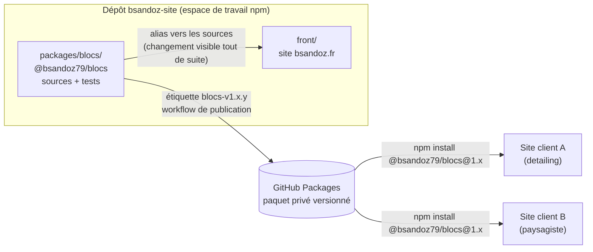
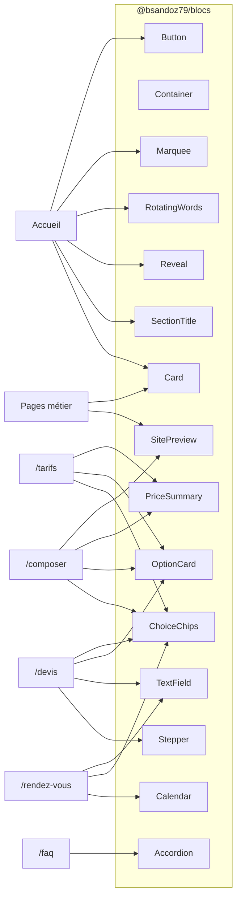

# Blocs réutilisables : la bibliothèque `@bsandoz79/blocs`

## À quoi ça sert
Une seule bibliothèque de blocs d'interface, **indépendants de tout site**, installable par n'importe quel site : bsandoz.fr aujourd'hui, les sites des clients ensuite. On écrit un calendrier une fois, on l'utilise partout, et chaque site garde ses couleurs.

## Schéma : un dépôt, une bibliothèque, plusieurs sites


## Schéma : qui utilise quoi dans bsandoz.fr


## Chemin
| Élément | Où |
| --- | --- |
| Sources des blocs | `packages/blocs/src/<Bloc>/` (`Bloc.tsx`, `.module.css`, `.test.tsx`, `index.ts`, `README.md`) |
| Point d'entrée | `packages/blocs/src/index.ts` (exporte tous les blocs) |
| Styles de base | `packages/blocs/src/styles/base.css` (variables par défaut sous `:where(:root)`, `.sr-only`), ajoutés en tête de `dist/blocs.css` au build |
| Build | `packages/blocs/vite.config.ts` → `dist/blocs.js` (sans React), `dist/blocs.css` (classes préfixées `bsb-`), `dist/types/` |
| Utilisation dans le site | alias `@bsandoz79/blocs` → `packages/blocs/src/index.ts` (`front/vite.config.ts`, `front/vitest.config.ts`, `front/tsconfig.app.json`) |
| Publication | `.github/workflows/blocs-publication.yml` (étiquette `blocs-vX.Y.Z`) |

## Comment l'appeler
```tsx
import { Calendar, OptionCard } from '@bsandoz79/blocs';
import '@bsandoz79/blocs/styles.css'; // dans un site client, une fois

<OptionCard title="Galerie photos" price="+ 80 €" checked={coche} onChange={setCoche} />
```
Installation dans un site client, personnalisation des couleurs, publication d'une version : `packages/blocs/README.md`.

## Contrat d'un bloc
- Aucun import de `front/` ni de données d'un site ; tout passe par les propriétés.
- CSS uniquement avec les variables (`--color-*`, `--space-*`…), dans son `*.module.css`.
- Animations déclarées dans son propre CSS et coupées si « réduire les animations ».
- Accessibilité : vrais éléments natifs, navigation clavier, textes lus par les lecteurs d'écran.
- Un `README.md` (utilisation, propriétés, accessibilité) et des tests unitaires.

## Catalogue
| Bloc | Rôle | Accessibilité clé |
| --- | --- | --- |
| Button | bouton ou lien, 3 variantes | vrai `<button>`/`<a>`, 44 px |
| Container | conteneur centré | balise au choix |
| Card | carte, 3 fonds | balise au choix |
| SectionTitle | sur-titre, titre, intro | vrai `h1`–`h3` |
| Reveal | apparition au défilement | visible d'emblée si animations réduites |
| RotatingWords | mots qui défilent | liste lue une fois |
| Marquee | bande défilante | copie cachée, figée si animations réduites |
| ChoiceChips | choix unique (pastilles ou cartes) | boutons radio, flèches |
| OptionCard | carte à cocher | case à cocher native |
| PriceSummary | récapitulatif de prix | total annoncé (`aria-live`) |
| SitePreview | faux site dessiné | description lue à la place |
| Stepper | étapes et progression | `aria-current="step"` |
| TextField | champ avec aide et erreur | `aria-describedby`, `aria-invalid` |
| Accordion | questions dépliables | `details`/`summary` natifs |
| Calendar | calendrier mensuel | grille ARIA, clavier complet |

## Versions
`packages/blocs/package.json` porte la version de la bibliothèque, indépendante de celle du site. Un site client choisit sa version et ne change que s'il le décide.

## Tests
- **unitaires** : un fichier par bloc (62 tests). Lancer : `npm run test -w packages/blocs`.
- **CI** : job « Bibliothèque de blocs » (lint, tests, build) à chaque push.
- **intégration** (fait à la création) : paquet installé dans un site client vierge (`npm pack`), type-check et build réussis, styles et variables présents.
