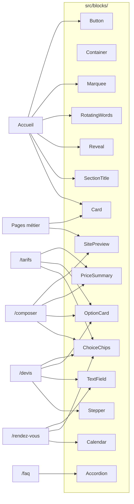

# Blocs réutilisables

## À quoi ça sert
Des briques d'interface **indépendantes de bsandoz.fr** : elles reçoivent tout (textes, données, actions) par leurs paramètres. Elles servent sur ce site et pourront servir sur les sites des clients.

## Schéma : qui utilise quoi


## Contrat d'un bloc
```
src/blocks/MonBloc/
  MonBloc.tsx          le composant (aucun import de src/data/)
  MonBloc.module.css   ses styles, uniquement avec les variables de tokens.css
  MonBloc.test.tsx     ses tests unitaires
  index.ts             ce qu'il expose
  README.md            son mode d'emploi : utilisation, propriétés, accessibilité
```

## Comment en appeler un
```tsx
import { Calendar } from '../blocks/Calendar';
import { OptionCard } from '../blocks/OptionCard';
```
Le mode d'emploi de chaque bloc (paramètres, exemples, accessibilité) est dans son `README.md` ; la liste est dans `docs/blocs.md`.

## Catalogue
| Bloc | Rôle | Accessibilité clé |
| --- | --- | --- |
| Button | bouton ou lien, 3 variantes | vrai `<button>`/`<a>`, 44 px |
| Container | conteneur centré | balise au choix |
| Card | carte, 3 fonds | balise au choix |
| SectionTitle | sur-titre, titre, intro | vrai `h1`–`h3` |
| Reveal | apparition au défilement | visible d'emblée si animations réduites |
| RotatingWords | mots qui défilent | liste lue une fois |
| Marquee | bande défilante | copie cachée, figée si animations réduites |
| ChoiceChips | choix unique (pastilles ou cartes) | boutons radio, flèches |
| OptionCard | carte à cocher | case à cocher native |
| PriceSummary | récapitulatif de prix | total annoncé (`aria-live`) |
| SitePreview | faux site dessiné | description lue à la place |
| Stepper | étapes et progression | `aria-current="step"` |
| TextField | champ avec aide et erreur | `aria-describedby`, `aria-invalid` |
| Accordion | questions dépliables | `details`/`summary` natifs |
| Calendar | calendrier mensuel | grille ARIA, clavier complet |

## Réutiliser sur un autre site
Aujourd'hui les blocs vivent dans ce dépôt (`front/src/blocks/`). Pour qu'un autre site les installe, il faudra les sortir dans un paquet versionné (proposition « A » en attente de validation).

## Tests
**unitaires** : un fichier par bloc, à côté du bloc. Lancer : `cd front && npm run test -- src/blocks`.
