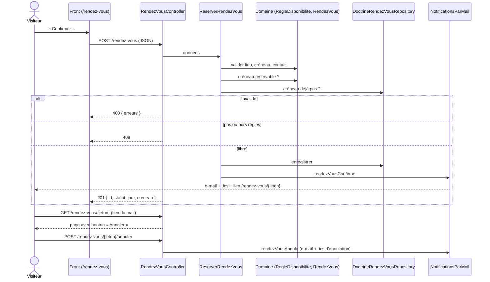

# Module Booking (API)

## À quoi ça sert
Enregistrer les rendez-vous pris sur la page `/rendez-vous`, refuser un créneau déjà pris, prévenir la personne et le professionnel par e-mail (avec fichier `.ics`), et permettre l'annulation par un lien reçu par mail. Le module est **autonome** : il s'installe dans l'API propre de chaque client.

## Schéma

## Chemin
| Élément | Fichier |
| --- | --- |
| Points d'entrée HTTP | `api/src/Booking/Infrastructure/Http/RendezVousController.php` |
| Cas d'usage | `api/src/Booking/Application/ReserverRendezVous.php`, `AnnulerRendezVous.php` |
| Règles métier | `api/src/Booking/Domain/` (`RegleDisponibilite`, `RendezVous`, `Creneau`, `Contact`, `Lieu`) |
| Base | `api/src/Booking/Infrastructure/Doctrine/` (dépôt + correspondance XML), `api/migrations/Version20261105185043.php` |
| E-mails et `.ics` | `api/src/Booking/Infrastructure/Mail/` |
| Réglages | `api/config/packages/booking.yaml`, variables `BOOKING_*` |

## Comment l'appeler
| Méthode | Adresse | Corps | Réponses |
| --- | --- | --- | --- |
| POST | `/rendez-vous` | `{ lieu, adresse, jour, creneau, nom, email, telephone, activite, message }` | 201 · 400 `{ erreurs: { champ: message } }` · 409 |
| GET | `/rendez-vous/{jeton}` | — | page HTML (200 · 404) |
| POST | `/rendez-vous/{jeton}/annuler` | — | page HTML (200 · 404) |

## Réutilisable ?
**Oui** : on copie `src/Booking/` et `config/packages/booking.yaml` dans l'API du client, on adapte les réglages (jours, créneaux, durée, fuseau, adresses e-mail) et on applique la migration. Marche à suivre : `api/src/Booking/README.md`.

## Tests
- **unitaires** : domaine (`tests/Booking/Domain/DomaineTest.php`), cas d'usage avec doublures (`tests/Booking/Application/CasUsageTest.php`), fichier `.ics` (`FichierIcsTest.php` : heures UTC, CRLF, échappement, lignes pliées sans couper un caractère, annulation), e-mails (`NotificationsParMailTest.php`, faux mailer).
- **fonctionnels** : `RendezVousHttpTest.php`, HTTP → base MySQL → mails : réservation, créneau pris, données invalides, corps non JSON, lien du mail sans effet, annulation qui libère le créneau, lien inconnu.
- **architecture** : `tests/Architecture/DomaineIndependantTest.php`.
- **CI** : migrations sur base vide, schéma validé, PHPUnit.

Lancer : voir `docs/api.md`.
