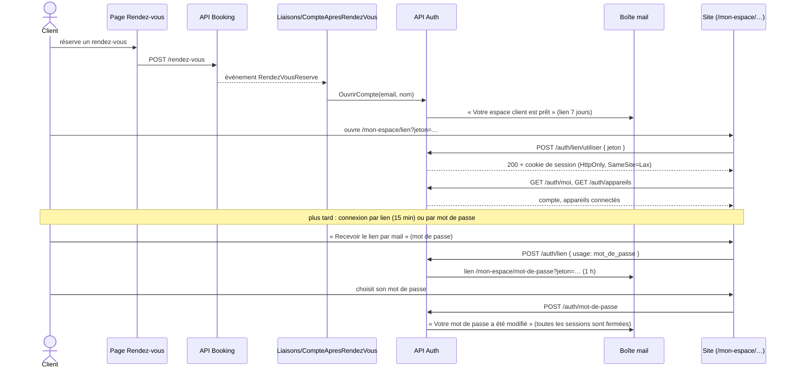

# Comptes et connexion

## À quoi ça sert
Donner à chaque client un espace personnel sans lui imposer d'inscription : le compte est ouvert automatiquement avec son premier rendez-vous (et plus tard sa première demande), activé par un lien reçu par mail. Il se connecte ensuite par un lien reçu par mail (sans mot de passe) ou par un mot de passe choisi depuis un lien sécurisé valable 1 h. Il voit ses appareils connectés et peut déconnecter les autres.

## Schéma

## Chemin
| Élément | Fichier |
| --- | --- |
| Pages du site | `front/src/pages/MonEspace/` : `Connexion.tsx`, `Lien.tsx`, `MotDePasse.tsx`, `MonEspace.tsx` (avec `MesDemandes.tsx`, `MesRendezVous.tsx`) |
| Appels à l'API | `front/src/pages/MonEspace/compte.ts`, `front/src/app/api.ts` (adresse `VITE_API_URL`, cookie inclus) |
| Textes | `front/src/data/espace.ts` ; adresses et titres : `front/src/data/pages.ts` |
| API | `api/src/Auth/` (domaine, cas d'usage, contrôleur, Doctrine, mails) |
| Ouverture du compte au premier rendez-vous | `api/src/Liaisons/CompteApresRendezVous.php` |
| Réglages | `api/config/packages/auth.yaml`, variables `AUTH_*`, `CORS_ALLOW_ORIGIN` |

## Comment l'appeler
- Pages : `/mon-espace` (réservée aux personnes connectées), `/mon-espace/connexion`, `/mon-espace/lien?jeton=…`, `/mon-espace/mot-de-passe` (avec ou sans `?jeton=…`), `/mon-espace/email?jeton=…`, `/mon-espace/suppression?jeton=…`. Exclues du sitemap, `noindex`, `Disallow: /mon-espace` dans robots.txt.
- API : voir `api/src/Auth/README.md` (`/auth/lien`, `/auth/lien/utiliser`, `/auth/connexion`, `/auth/mot-de-passe`, `/auth/moi`, `/auth/deconnexion`, `/auth/appareils`, `/auth/appareils/deconnecter-les-autres`).
- Ouvrir un compte depuis un autre module de l'API : `OuvrirCompte($email, $nom)` (rien ne change si le compte existe).

## Mon compte, confidentialité, zone danger
- **Mon compte** (`MonCompteSection.tsx` → `POST /auth/compte`) : nom, entreprise, téléphone, adresse. **Changer d'e-mail** (`POST /auth/email`) envoie un lien à la nouvelle adresse ; la page `/mon-espace/email` le confirme (`POST /auth/email/confirmer`) et l'ancienne adresse est prévenue.
- **Confidentialité** (`Confidentialite.tsx`) : état de la localisation dans ce navigateur (rien n'est stocké côté serveur) et aide pour la réactiver ; notifications par mail (décochées : plus de rappel la veille ni de mail « nouveau message », les mails importants partent toujours) ; **Télécharger mes données** (`GET /espace/donnees`, JSON sans aucun secret).
- **Zone danger** (`ZoneDanger.tsx`) : confirmation en deux temps, puis lien par mail vers `/mon-espace/suppression`, où un clic explicite supprime le compte (`POST /auth/suppression/confirmer`). L'événement `CompteSupprime` efface aussi les rendez-vous (liaison `DonneesApresSuppression`, les rendez-vous à venir sont d'abord annulés).

## Sécurité, en bref
Secrets jamais stockés (empreinte SHA-256) ni renvoyés par l'API ; liens à usage unique et de courte durée ; cookie `HttpOnly`, `SameSite=Lax`, `Secure` en production ; pas d'énumération des comptes ; 5 essais par quart d'heure ; corps JSON obligatoire et CORS limité au site ; changement de mot de passe = toutes les sessions fermées + mail.

## Réutilisable ?
- Module Auth : **oui**, il s'installe dans l'API d'un client (notice dans `api/src/Auth/README.md`).
- Pages du site : propres à bsandoz.fr, mais simples à reprendre (elles n'utilisent que `compte.ts` et les blocs `Button`, `TextField`, `Container`).

## Tests
- **unitaires** : domaine et cas d'usage (`api/tests/Auth/Domain`, `api/tests/Auth/Application`), appareils, hachage, mails (`AppareilEtMailsTest.php`), règle du mot de passe côté site.
- **fonctionnels** : `api/tests/Auth/Infrastructure/AuthHttpTest.php` (HTTP + MySQL + vrai cookie), `api/tests/Liaisons/CompteApresRendezVousTest.php`, `front/src/pages/MonEspace/MonEspace.test.tsx` (connexion, erreurs, lien utilisé une seule fois même en StrictMode, mot de passe, espace, appareils, déconnexion).
- **architecture** : le domaine Auth ne dépend ni de Symfony ni de Doctrine.
