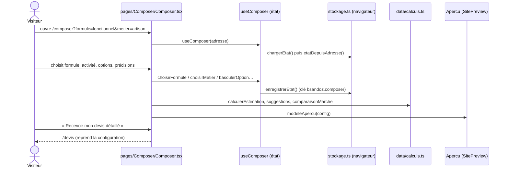

# Configurateur « Composer mon site »

## À quoi ça sert
Le visiteur compose son site étape par étape et voit le prix et l'aperçu se mettre à jour. Ses choix sont gardés dans son navigateur et repris par la demande de devis.

## Schéma

## Chemin
| Étape | Fichier | Rôle |
| --- | --- | --- |
| Page et onglets | `pages/Composer/Composer.tsx` | onglets ARIA (flèches, Début, Fin), deux colonnes |
| État | `pages/Composer/useComposer.ts` | actions : formule, métier, option, précision, suggestion, recommencer |
| Mémoire | `pages/Composer/stockage.ts` | lecture validée, écriture sans erreur si le stockage est bloqué, adresse |
| Étapes « Sites & applis » | `pages/Composer/ConfigurateurWeb.tsx` | type, activité, options, précisions, suggestions |
| Estimation | `pages/Composer/Estimation.tsx`, `ComparaisonMarche.tsx` | bloc `PriceSummary`, valeur barrée, offert, fourchette, marché |
| Informatique | `pages/Composer/ConfigurateurInformatique.tsx` | public, prestations, « Tarif sur devis » |
| Aperçu | `pages/Composer/Apercu.tsx` | `SitePreview` ou « Bon à savoir » ; masqué sous 1 000 px |
| Textes | `data/configurateur.ts` | |

## Comment l'appeler
- Lien simple : `/composer`.
- Préremplir : `?formule=vitrine|vitrinePlus|fonctionnel`, `?metier=artisan|commerce|restaurant|sante|autre`, `?onglet=informatique`. Exemple : `/composer?formule=fonctionnel&metier=sante`.
- Lire la configuration ailleurs : `chargerEtat().config` (utilisé par `/devis`).

## Réutilisable ?
La page est propre au site. Ce qui se réutilise : les blocs (`ChoiceChips`, `OptionCard`, `PriceSummary`, `SitePreview`) et les calculs (`data/calculs.ts`).

## Tests
- **unitaires** : `stockage.test.ts` (valeurs inconnues ignorées, stockage bloqué, adresse).
- **fonctionnels** : `Composer.test.tsx` (étapes successives, précisions et supplément, pack offert par suggestion, marché, préremplissage, mémorisation, « Recommencer », onglets au clavier, informatique, aperçu).

## Reprendre ou recommencer
- **Ce qui est gardé** : les choix restent enregistrés dans le navigateur (`bsandoz.composer`), car le devis les reprend.
- **Repérer la visite** : `bsandoz.composer.visite`, dans le stockage de session, oublié à la fermeture de l'onglet.
- **Nouvelle visite** (`estNouvelleVisite`) : si une estimation est enregistrée (`aDesChoix`), la fenêtre `Reprise` s'ouvre avec un résumé (`resumeEtat`, par exemple « Site Vitrine · 1 option »).
  - « Oui, reprendre » (ou Échap) garde l'estimation.
  - « Non, recommencer » repart de zéro (`repartirDeZero`), en appliquant l'adresse suivie (`?onglet=`, `?formule=`, `?metier=`).
- **Accessibilité de la fenêtre** : vraie fenêtre (`role="dialog"`, `aria-modal`), focus sur « Oui » à l'ouverture, Tab qui tourne entre les deux boutons.
- **Simulateur des Tarifs** : il marque aussi la visite. Une simulation suivie du configurateur ne pose donc pas la question.
