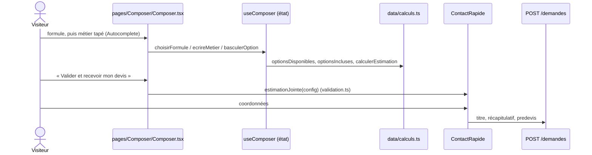

# Estimation en ligne (`/composer`)

## À quoi ça sert
Le visiteur estime le prix de son site, puis **valide** : son estimation devient une demande de devis. Elle est proposée en second plan : le bouton principal du site reste « Demander un devis ». On y accède par un lien discret sur la page Devis (« Faire une estimation en ligne ») et sur la page Tarifs (« Ou estimez-le en ligne »).

(Retirée puis remise le 2026-11-07, à la demande de Baptiste, avec les changements ci-dessous.)

## Ce qui a changé au retour
- **Métier à écrire** : bloc `Autocomplete`. On tape « me », il propose menuisier, mécanicien… Un métier absent de la liste est gardé tel qu'il est écrit.
  - La liste et la catégorie de chaque métier sont dans `data/metiersConnus.ts`. La catégorie choisit les gros modules proposés pour le Fonctionnel.
  - `categorieDuMetier(nom)` donne la catégorie, ou « autre » pour un métier inconnu.
- **Options incluses** : 1 en Vitrine, 2 en Vitrine+, 3 en Fonctionnel (`inclusParFormule`, `data/offres.ts`).
  - Seules les petites options peuvent être incluses. Les gros modules (`gros: true` : rendez-vous, calculateur, appli, espace client, boutique, table, click & collect) restent toujours payants.
  - Les premières petites options cochées sont incluses. Les suivantes restent possibles, au prix affiché.
  - L'étape le dit : « 2 options incluses… Encore 1 à choisir ».
  - Les cartes incluses portent le badge « Inclus » et l'estimation les barre.
- **Plus de choix** : toutes les petites options sont proposées avec chaque formule. Pour le Fonctionnel, elles s'ajoutent aux gros modules du métier.
- **Packs supprimés**, remplacés par les options incluses.
- **Aperçu** : légendé « Exemple · squelette sans style : il montre seulement où se placent les parties. Votre site aura son propre design. »
- **Valider** : « Valider et recevoir mon devis » ouvre, sous l'estimation, le formulaire de contact (`ContactRapide`) avec l'estimation jointe.
  - Le métier est déjà rempli, et le projet devient facultatif.
  - À l'envoi : `titre` = formule et options, `recapitulatif` commence par « Origine : Estimation en ligne », `predevis` = texte de l'estimation. L'accusé de réception le reprend.

## Schéma

## Chemin
| Étape | Fichier | Rôle |
| --- | --- | --- |
| Page et onglets | `pages/Composer/Composer.tsx` | onglets ARIA, deux colonnes, formulaire après validation |
| État | `pages/Composer/useComposer.ts` | `ecrireMetier` (nom + catégorie), options, précisions, suggestions |
| Étapes « Sites & applis » | `pages/Composer/ConfigurateurWeb.tsx` | type, métier, options (incluses), précisions, suggestions |
| Estimation | `pages/Composer/Estimation.tsx` | `PriceSummary`, valeur barrée, « Inclus », marché, « Valider » |
| Validation | `pages/Composer/validation.ts` | `estimationJointe(config)` : titre, lignes, texte |
| Calculs | `data/calculs.ts` | `optionsIncluses`, `inclusRestantes`, `calculerEstimation` |
| Texte de l'estimation | `data/predevis.ts` | `preDevis(config)`, `texteDuPreDevis` |
| Métiers | `data/metiersConnus.ts` | liste, catégories |
| Mémoire | `pages/Composer/stockage.ts` | choix gardés, fenêtre « reprendre là où vous en étiez » |

## Comment l'appeler
- `/composer?onglet=web` (lien `lienEstimation`, `data/navigation.ts`).
- Préremplir : `?formule=vitrine|vitrinePlus|fonctionnel`, `?onglet=informatique`.

## Réutilisable ?
La page est propre au site. Les blocs (`Autocomplete`, `ChoiceChips`, `OptionCard`, `PriceSummary`, `SitePreview`) et les calculs se réutilisent.

## Tests
- `Composer.test.tsx` : étapes, suggestions de métier, options incluses (Vitrine, Vitrine+), gros module jamais inclus, métier libre, précisions, marché, aperçu « squelette », reprise, onglets, et validation de bout en bout avec envoi.
- `calculs.test.ts`, `predevis.test.ts`, `apercu.test.ts`, `stockage.test.ts`.
- `Autocomplete.test.tsx` (bloc).
- Lancer : `npm run test -w front -- Composer calculs predevis`.
