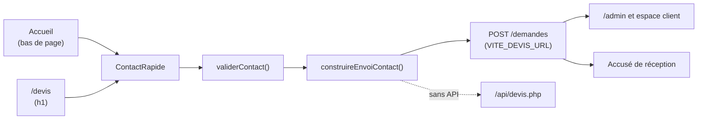

# Demande de devis

## À quoi ça sert
Recevoir une demande de projet en moins d'une minute. Pas d'estimation automatique : Baptiste lit la demande et répond sous 24 h avec une proposition.

C'est le seul formulaire du site. Il est à deux endroits :
- en bas de l'accueil, sous le titre « Parlez-moi de votre projet. » ;
- sur la page `/devis`, avec le titre de la page en `h1`.

## Le formulaire
- **Champs obligatoires** : prénom et nom, e-mail, téléphone, domaine d'activité, projet (10 caractères au moins), consentement.
- **Champ facultatif** : entreprise.
- **Métier ou activité** : champ `Autocomplete` qui propose de finir le mot (liste `data/metiersConnus.ts`, plus « Particulier »). On peut aussi écrire librement.
- **Anti-robots** :
  - un champ piège `site_web`, invisible ;
  - un envoi par minute depuis le navigateur ;
  - côté serveur, la limite de l'API ou de `devis.php`.

## Le chemin
1. `components/ContactRapide/ContactRapide.tsx` affiche le formulaire. Ses textes et la liste des activités sont dans `data/contact.ts`.
2. `validerContact` (`components/ContactRapide/contact.ts`) contrôle les champs.
3. `construireEnvoiContact` prépare les données :
   - `nom`, `email`, `telephone`, `entreprise` ;
   - `titre` (« Projet · Artisan, bâtiment ») ;
   - `recapitulatif` (activité, projet, coordonnées) ;
   - `predevis` vide ;
   - `site_web`.
4. Elles sont envoyées à `urlEnvoiDevis` (`data/devis.ts`) :
   - `VITE_DEVIS_URL`, c'est-à-dire l'API `POST /demandes` : la demande est enregistrée, visible dans `/admin` et l'espace client ;
   - sinon `/api/devis.php`, qui envoie seulement un mail.
5. Le client reçoit un accusé de réception : « Je vous réponds sous 24 h avec une proposition. »

## Comment l'appeler
- **Composant** : `<ContactRapide />`, ou `<ContactRapide titre="Demande de devis" niveau={1} />` pour une page dédiée.
- **Adresse** : `/devis`. Tous les boutons y mènent : « Demander un devis » de l'en-tête, du pied de page et de la barre mobile, Tarifs, pages métier, réalisations, Informatique sur place. Les anciennes adresses `/composer` et `/tarifs` redirigent ici.

## Réutilisable ?
Oui. Le composant ne dépend que de `TextField`, `ChoiceChips` et `Button`, et la liste des activités est une donnée. L'API attend toujours le même contrat qu'avant : il n'a pas changé.

## Tests
- `ContactRapide.test.tsx` : validation, « Autre », contenu envoyé, merci, échec, limite.
- `Devis.test.tsx` : un seul formulaire, sans étapes ni estimation, et redirection de `/composer`.
- Lancer : `npm run test -w front -- ContactRapide Devis`.
