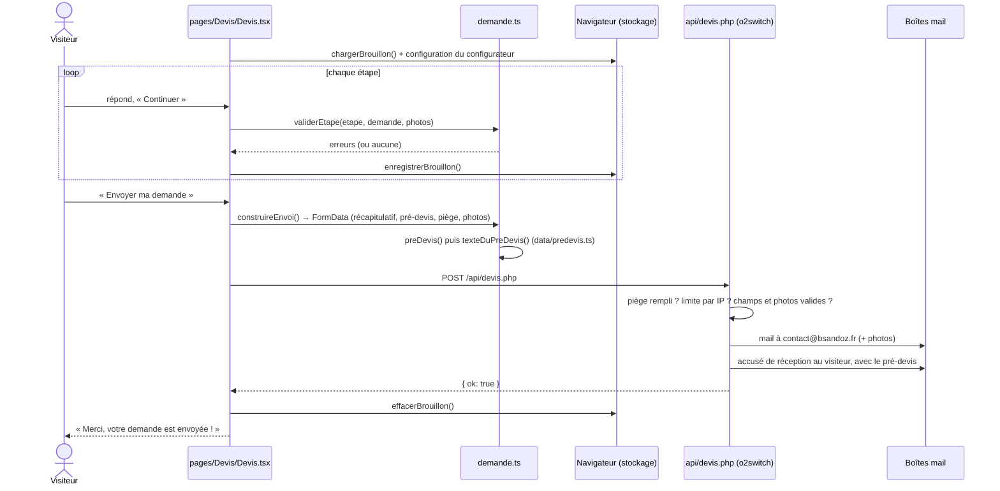
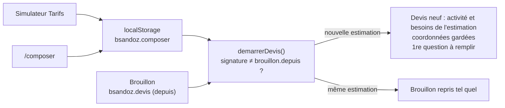

# Demande de devis

## À quoi ça sert
Recueillir une demande complète en 5 étapes (activité, besoins, projet avec ses mots, budget et délai, coordonnées), sans rien perdre en route, puis l'envoyer par e-mail à Baptiste avec un accusé de réception au visiteur, qui contient un **pré-devis automatique** (formule conseillée, fourchette de prix, délai, 3 options suggérées au plus).

## Schéma

## Chemin
| Élément | Fichier |
| --- | --- |
| Page, étapes, focus, envoi | `pages/Devis/Devis.tsx`, `pages/Devis/Etapes.tsx` |
| Validation, brouillon, récapitulatif, `FormData` | `pages/Devis/demande.ts` |
| Pré-devis (formule, fourchette, suggestions, texte) | `data/predevis.ts` (prix de `data/offres.ts` et `data/calculs.ts`) |
| Textes, besoins, budgets, délais, limites des photos | `data/devis.ts` |
| Réception et mails | `front/public/api/devis.php` (copié dans `dist/api/`) |

## Avec l'API (V3)
Une fois l'API en ligne, construire le site avec `VITE_DEVIS_URL=https://api.bsandoz.fr/demandes` : le même formulaire est alors reçu par le module Prospect (`POST /demandes`). La demande est enregistrée et numérotée (« 2026-014 »), le compte client est ouvert (lien d'activation), et le client suit sa demande, accepte son devis et le télécharge en PDF dans `/mon-espace` (`pages/MonEspace/MesDemandes.tsx`). Sans cette variable, `devis.php` continue d'envoyer la demande par mail. Détails : `api/src/Prospect/README.md`.

## Comment l'appeler
- Page : `/devis` (reprend la configuration de `/composer` si elle existe).
- Script : `POST /api/devis.php`, `multipart/form-data` : `nom`, `email`, `recapitulatif`, `predevis` (texte brut, facultatif, 3 000 caractères au plus), `site_web` (piège, vide), `photos[]` (3 au plus). Réponses : `200 {ok:true}`, `400`, `405`, `429` (trop d'envois), `500`.

## Protection
Champ piège invisible · 1 envoi par minute dans le navigateur · côté serveur 1 par minute et 3 par heure par empreinte d'IP · photos JPEG/PNG/WebP vérifiées sur leur contenu, 5 Mo max · en-têtes protégés contre l'injection.

## Réutilisable ?
- `Stepper`, `TextField` : **oui**.
- `devis.php` : adaptable à un autre site en changeant `DESTINATAIRE` et `EXPEDITEUR`.
- Le parcours lui-même est propre au site.

## Tests
- **unitaires** : `demande.test.ts` (validation de chaque étape, photos, brouillon, récapitulatif, `FormData` avec le pré-devis), `data/predevis.test.ts`.
- **fonctionnels** : `Devis.test.tsx` (progression, erreurs expliquées, retour sans perte, brouillon repris, configuration reprise, envoi réussi, échec, patienter entre deux envois).
- **manuel** : script vérifié dans un conteneur PHP 8.3 avec un faux `sendmail` (avec et sans pré-devis, pré-devis trop long tronqué, retours chariot retirés) ; l'envoi réel de mail se teste sur o2switch.

## Contact rapide
En bas de l'accueil, `components/ContactRapide` propose un formulaire court (nom, téléphone, e-mail, besoin, projet). Il envoie le même formulaire que la demande de devis, à la même adresse (`urlEnvoiDevis`) : même accusé de réception, même suivi dans l'espace client une fois l'API en ligne.

## Reprise de la dernière estimation
Le configurateur (`/composer`) et le simulateur de la page Tarifs enregistrent la dernière estimation dans le navigateur (`bsandoz.composer`). En arrivant sur `/devis`, `demarrerDevis` (`pages/Devis/demande.ts`) compare son empreinte (`signatureEstimation` : formule, activité, options, précisions) à celle dont le brouillon est parti (`depuis`).
- **Nouvelle estimation**, c'est-à-dire une autre simulation : **devis neuf**, rien des essais précédents.
  - Seuls sont cochés l'activité choisie dans l'estimation et les besoins des options réellement choisies (`besoinsDepuisEstimation`, rien d'ajouté d'office).
  - Les coordonnées (nom, entreprise, e-mail, téléphone) sont gardées, pour ne pas les retaper.
  - Le devis s'ouvre sur la première question à remplir (`etapeDeReprise`).
- **Même estimation** : le brouillon est repris là où il s'était arrêté.
- **Pas d'estimation** : le parcours habituel.

**L'étape « Besoins » est sautée** quand le devis part d'une estimation (`etapesActives`) : la formule et les options disent déjà ce que le site doit faire. Le parcours a alors 4 étapes : Activité, Avec vos mots, Budget et délai, Coordonnées. Elle revient sans estimation, ou après « Repartir de zéro ». Ce choix est gardé au rechargement grâce à la marque `zero:` dans le brouillon.

Un bandeau « Repris de votre estimation » rappelle la formule, les options et le prix. Son lien « Repartir de zéro » vide les questions du projet, garde les coordonnées et revient à la première étape (`demandeRemiseAZero`).

Tests :
- `demande.test.ts` : besoins réellement choisis, nouvelle estimation (devis neuf), même estimation, absence d'estimation, empreinte, remise à zéro ;
- `Devis.test.tsx` : ouverture sur « Avec vos mots » avec les choix cochés, autre simulation puis retour, « Repartir de zéro » ;
- `Tarifs.test.tsx` : le simulateur enregistre sa simulation.

## Liens des mails
Le pré-devis envoyé par mail (`texteDuPreDevis`, `data/predevis.ts`) termine par un lien vers la prise de rendez-vous. Ce lien utilise `origineDuSite()` (`data/pages.ts`), c'est-à-dire l'adresse du site d'où part la demande : une demande faite sur preview.bsandoz.fr mène à preview, une demande faite sur bsandoz.fr mène à bsandoz.fr. Le plan du site et les adresses canoniques gardent l'adresse publique `site.url`. Les liens des mails envoyés par l'API viennent, eux, des réglages du serveur : `AUTH_URL_SITE`, `BOOKING_URL_PUBLIQUE`, `PROSPECT_URL_SITE`.

## Autre activité
Choisir « Autre activité » ouvre le champ « Précisez votre activité » (`metierAutreTextes`, `data/offres.ts`) :
- **configurateur et simulateur** : champ facultatif ;
- **devis** : champ obligatoire, 2 caractères au moins.

L'activité précisée est gardée dans `Configuration.metierAutre` (configurateur et simulateur) et `Demande.metierAutre` (devis). Elle passe de l'estimation au devis. `nomActivite()` l'affiche à la place de « Autre activité » : estimation, aperçu, récapitulatif, mail.
