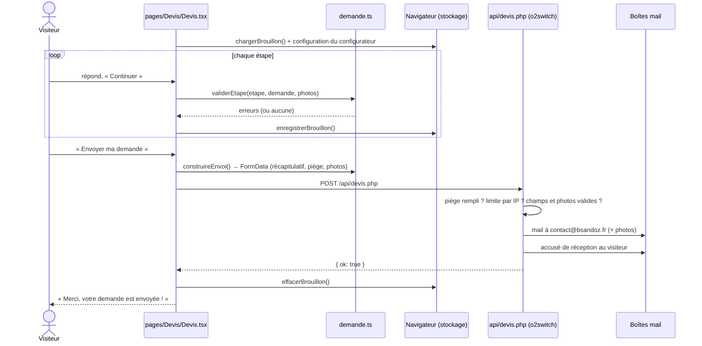

# Demande de devis

## À quoi ça sert
Recueillir une demande complète en 5 étapes (activité, besoins, projet avec ses mots, budget et délai, coordonnées), sans rien perdre en route, puis l'envoyer par e-mail à Baptiste avec un accusé de réception au visiteur.

## Schéma

## Chemin
| Élément | Fichier |
| --- | --- |
| Page, étapes, focus, envoi | `pages/Devis/Devis.tsx`, `pages/Devis/Etapes.tsx` |
| Validation, brouillon, récapitulatif, `FormData` | `pages/Devis/demande.ts` |
| Textes, besoins, budgets, délais, limites des photos | `data/devis.ts` |
| Réception et mails | `front/public/api/devis.php` (copié dans `dist/api/`) |

## Comment l'appeler
- Page : `/devis` (reprend la configuration de `/composer` si elle existe).
- Script : `POST /api/devis.php`, `multipart/form-data` : `nom`, `email`, `recapitulatif`, `site_web` (piège, vide), `photos[]` (3 au plus). Réponses : `200 {ok:true}`, `400`, `405`, `429` (trop d'envois), `500`.

## Protection
Champ piège invisible · 1 envoi par minute dans le navigateur · côté serveur 1 par minute et 3 par heure par empreinte d'IP · photos JPEG/PNG/WebP vérifiées sur leur contenu, 5 Mo max · en-têtes protégés contre l'injection.

## Réutilisable ?
- `Stepper`, `TextField` : **oui**.
- `devis.php` : adaptable à un autre site en changeant `DESTINATAIRE` et `EXPEDITEUR`.
- Le parcours lui-même est propre au site.

## Tests
- **unitaires** : `demande.test.ts` (validation de chaque étape, photos, brouillon, récapitulatif, `FormData`).
- **fonctionnels** : `Devis.test.tsx` (progression, erreurs expliquées, retour sans perte, brouillon repris, configuration reprise, envoi réussi, échec, patienter entre deux envois).
- **manuel** : script vérifié dans un conteneur PHP 8.3 ; l'envoi réel de mail se teste sur o2switch.
