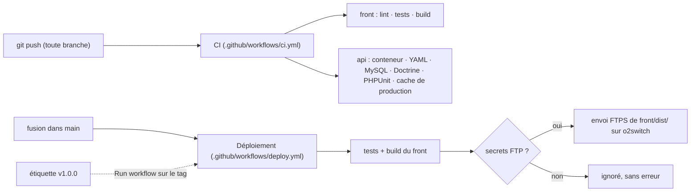

# Déploiement et intégration continue

## À quoi ça sert
Vérifier automatiquement chaque push, publier `main` sur o2switch, et pouvoir revenir à la V1.

## Schéma

## Comment l'appeler
- Rien à faire : chaque push lance la CI, chaque fusion dans `main` lance le déploiement.
- Remettre la V1 : GitHub → Actions → **Déploiement o2switch** → **Run workflow** → **Tags → v1.0.0**.
- Secrets à créer : `FTP_SERVER`, `FTP_USERNAME`, `FTP_PASSWORD`, `FTP_SERVER_DIR`.

Mise en ligne pas à pas, API comprise : `docs/mise-en-ligne.md`. L'API s'envoie par le workflow manuel `deploy-api.yml`.

## Réutilisable
`.github/workflows/ci.yml` · `.github/workflows/deploy.yml` · `front/public/.htaccess` · détails dans `docs/deploiement.md`.

## Pièges connus
- Une valeur YAML sans guillemets ne doit pas contenir « : » (workflow refusé par GitHub).
- `.env.dist` et `.env.test` de l'API sont versionnés (sans secret) ; les autres `.env*` ne le sont jamais.
