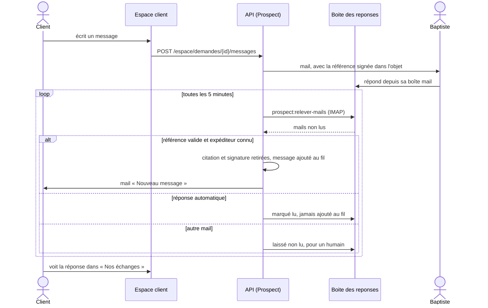

# Fil de messages

## À quoi ça sert
Garder au même endroit tous les échanges d'une demande de devis : messages écrits dans l'espace client ou le back-office, réponses reçues par mail, notes d'appel. Le client et Baptiste peuvent répondre depuis le site **ou** depuis leur boîte mail : tout arrive dans le même fil.

## Schéma

## Chemin
| Élément | Fichier |
| --- | --- |
| Écran | `front/src/pages/MonEspace/FilDeMessages.tsx`, dans `MesDemandes.tsx` ; textes : `front/src/data/espace.ts` (`demandes.fil`) |
| Point d'entrée | `api/src/Liaisons/EspaceDemandesController.php` (liaison Auth + Prospect) |
| Cas d'usage | `api/src/Prospect/Application/EcrireMessage.php`, `ReleverLesReponses.php` |
| Règles | `api/src/Prospect/Domain/` : `Message`, `TexteDeReponse` (retire citations et signatures) |
| Relevé | `api/src/Prospect/Infrastructure/Imap/` (client IMAP, lecture des mails), `Console/ReleverMailsCommand.php` |
| Référence signée | `api/src/Prospect/Infrastructure/Systeme/ReferencesSignees.php` |
| Base | table `prospect_message`, migration `Version20261106090000.php` |

## Comment l'appeler
| Méthode | Adresse | Corps | Réponses |
| --- | --- | --- | --- |
| GET | `/espace/demandes` | — | chaque demande contient `messages: [{ id, auteur, origine, corps, envoyeLe }]` |
| POST | `/espace/demandes/{id}/messages` | `{ corps }` | 201 `{ demande }` · 400 · 401 · 404 · 415 · 429 (20 par heure) |

Relevé : `php bin/console prospect:relever-mails`, en tâche planifiée toutes les 5 minutes. Réglages : `PROSPECT_BOITE_REPONSES`, `PROSPECT_IMAP_*` (voir `api/.env.dist`). Tant que `PROSPECT_BOITE_REPONSES` est vide, le fil marche sur le site et une réponse par mail va directement à l'autre personne, hors du fil.

## Sécurité
- Une réponse n'entre dans le fil que si la référence de l'objet est valide (signée avec `APP_SECRET`) **et** si l'expéditeur est le client de cette demande ou le professionnel. L'expéditeur seul peut être falsifié, d'où la signature.
- Changer `APP_SECRET` rend caduques les références déjà envoyées : ces réponses restent alors non lues dans la boîte.
- Réponses automatiques ignorées : une absence du bureau ne relance pas le fil.
- Texte seul : le HTML est retiré, les pièces jointes ne sont pas conservées (elles restent dans la boîte).
- Le certificat du serveur de mail est vérifié, et le mot de passe n'apparaît pas dans les messages d'erreur.

## Réutilisable ?
Oui, avec le module Prospect : voir `docs/mise-en-place/demandes-de-devis.md`.

## Tests
- **unitaires** : `api/tests/Prospect/FilDeMessagesTest.php` (droits, note sans mail, faux expéditeur, fausse référence, réponse automatique, doublon, nettoyage des citations), `front/src/pages/MonEspace/MesDemandes.test.tsx`.
- **fonctionnels** : `DemandesHttpTest.php` (HTTP + MySQL : écrire, refus, 429, demande d'un autre, export, effacement).
- **sur un vrai serveur IMAP** : `ImapEtReferencesTest.php` avec GreenMail (ignoré sans `IMAP_TEST_HOTE`, la CI le fournit).

Lancer : voir `docs/api.md`, `npm run test -w front`.
