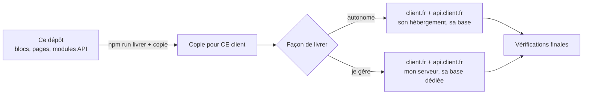

# Mise en place chez un client

## À quoi ça sert
Installer une fonctionnalité sur le site d'un client, sur un autre domaine, sans rien oublier, et selon l'une des deux façons de livrer : **client autonome** (cas normal) ou **je gère pour lui** (à sa demande).

## Schéma

## Chemin
| Élément | Fichier |
| --- | --- |
| Choisir la façon de livrer et la fiche | `docs/mise-en-place/README.md` |
| Site, API, base, mails, domaine, vérifications | `docs/mise-en-place/commun.md` |
| Une fiche par fonctionnalité | `docs/mise-en-place/` : `blocs.md`, `prix-et-referencement.md`, `devis-par-mail.md`, `rendez-vous.md`, `demandes-de-devis.md`, `espace-client.md` |
| Copie des blocs | `npm run livrer` (`packages/blocs/scripts/livrer.mjs`) |
| Notices des modules | `api/src/Booking/README.md`, `api/src/Auth/README.md`, `api/src/Prospect/README.md` |

## Comment l'appeler
Lire `docs/mise-en-place/README.md`, puis la fiche voulue. Commande : `npm run livrer -- <Blocs> --vers <dossier>` (`--liste` pour les blocs disponibles).

## Réutilisable ?
C'est son objet. Ce qui se copie tel quel : les blocs et les modules de l'API, seuls ou ensemble. Ce qui reste à adapter à chaque client : textes, prix, horaires, mentions légales, mentions du devis PDF.

## Limites
- Espace client : seule la combinaison des trois modules est prête.
- Pas de back-office : pas de devis ni de changement de statut sans code.
- L'API ne sépare pas plusieurs clients : une installation par client.
- Le cookie de connexion impose le site et l'API sur le même domaine.
- Jamais essayé sur un vrai hébergement, ni avec un envoi réel de mails.

## Tests
- **manuel** : détail et résultats dans `docs/journal/30-docs-mise-en-place-client.md`.
- **vérification** : liens et ancres de `docs/mise-en-place/` contrôlés, schémas affichés par Mermaid 11 dans Chrome.
