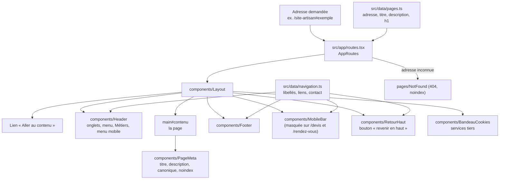
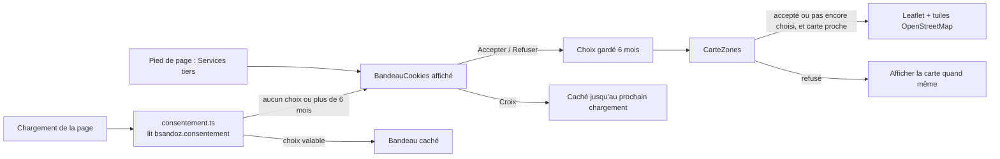

# Navigation et mise en page

## À quoi ça sert
Donner à chaque page son adresse, son titre et sa description, et entourer toutes les pages de la même mise en page : lien d'évitement, en-tête, contenu, pied de page, barre « Estimer » sur mobile.

## Schéma

## Chemin
1. `AppRoutes` (`src/app/routes.tsx`) crée une route par entrée de `pages` et affiche le composant prévu dans `builtPages`.
2. `Layout` (`src/components/Layout/Layout.tsx`) : à chaque changement d'adresse, défile vers l'ancre (`#…`) si elle existe, sinon en haut.
3. `Header` (`src/components/Header/`) : l'onglet « Informatique sur place » est actif sur les adresses qui commencent par `/informatique`, sinon « Sites & applis ». Les menus se ferment à l'Échap, au clic en dehors et au changement de page.
4. Chaque page appelle `PageMeta` pour son titre d'onglet (« Titre – Baptiste Sandoz ») et sa description.

## Comment l'appeler
- Ajouter une page : une entrée dans `src/data/pages.ts`, un dossier dans `src/pages/`, une ligne dans `builtPages`.
- Ajouter un lien de menu : `header.links` dans `src/data/navigation.ts`.
- Téléphone et adresse : `contact.phone` et `contact.adresse` dans `src/data/navigation.ts` (repris par le pied de page, le contact, les mentions légales et les données structurées).

## Réutilisable ?
- Les blocs `Button` et `Container` : oui, tels quels.
- `Header`, `Footer`, `MobileBar`, `Layout` : propres à ce site (ils lisent `data/navigation.ts`), mais leur structure se recopie facilement.

## Tests
- **fonctionnels** : `src/app/routes.test.tsx` (chaque adresse, 404), `Header.test.tsx` (menu mobile, Échap, clic en dehors, onglet actif), `Layout.test.tsx` (lien d'évitement, ancre), `Footer.test.tsx`, `MobileBar.test.tsx`, `RetourHaut.test.tsx` (caché en haut de page, visible après 600 px, remonte au clic, placé au-dessus de la barre mobile), `BandeauCookies.test.tsx`, `app/consentement.test.ts`.
- **unitaires** : `PageMeta.test.tsx`.

## Fichiers
`src/data/pages.ts` · `src/data/navigation.ts` · `src/app/routes.tsx` · `src/components/{Layout,Header,Footer,MobileBar,RetourHaut,PageMeta}/`

## Défilement
L'en-tête est collé en haut de l'écran. `components/Header/useMasquageAuDefilement.ts` le cache quand on descend (au-delà de 80 px, mouvements de plus de 8 px) et le réaffiche dès qu'on remonte. Il reste visible quand le menu est ouvert ou que le focus clavier est dedans.

## Pied de page
Fond bleu marine : bande d'appel à l'action (estimer, rendez-vous), présentation, « Le site », « Contact », puis droits et pages légales (`components/Footer`, textes dans `data/navigation.ts`).

## Revenir en haut
`components/RetourHaut` : petit bouton rond et transparent (verre dépoli) avec une flèche, en bas à droite. Il apparaît une fois la page descendue de plus de `retourHaut.seuil` (600 px, `data/navigation.ts`) et ramène en haut au clic : en douceur, ou d'un coup si le visiteur réduit les animations. Caché, il est hors du parcours clavier. Sur mobile, il se pose au-dessus de la barre « Estimer » quand elle est affichée (`barreMobileVisible`, `components/MobileBar`).

## Bandeau des services tiers
- **Le bandeau** (`components/BandeauCookies`) est une bande en verre dépoli en bas de l'écran. Ce n'est pas une fenêtre : la page reste utilisable et le focus n'est pas capturé. Sur mobile, il se place au-dessus de la barre « Estimer ».
- **Le choix** est géré par `src/app/consentement.ts` (`useConsentement`, `choisir`, `fermerPourLInstant`, `rouvrirBandeau`) :
  - « Accepter » ou « Refuser » est gardé 6 mois dans le navigateur (clé `bsandoz.consentement`, avec la date), puis redemandé ;
  - la croix cache le bandeau pour la visite, et il revient au prochain chargement ;
  - le bouton « Services tiers » du pied de page rouvre le bandeau.
- **Ce qui en dépend** : la carte des zones. Elle se charge seule quand on approche (`IntersectionObserver`, 300 px d'avance) ; si le visiteur a refusé, un bouton « Afficher la carte quand même » vaut acceptation.
- **Pas d'autre service tiers** : les polices sont hébergées avec le site, et il n'y a ni cookie publicitaire ni mesure d'audience.
- **Textes** : `data/consentement.ts`.

La position du visiteur sur la carte est décrite dans [pages-de-contenu.md](pages-de-contenu.md#carte-des-zones-et-position).

## Boutons « Demander un devis »
L'estimation en ligne est retirée (2026-11-07). Le bouton de l'en-tête, la barre mobile et le pied de page mènent tous à `/devis` (`lienDevis`, `data/navigation.ts`). L'estimation (`/composer`, `lienEstimation`) n'est proposée qu'en lien secondaire, sur la page Devis et sur Tarifs. Sur `/composer`, l'en-tête n'affiche pas sa barre d'onglets (classe `sansOnglets`), et la barre mobile est masquée. Le pied de page n'affiche pas son appel sur l'accueil ni sur `/devis`, qui se terminent déjà par le formulaire.

## Espace client dans l'en-tête
Le lien « Espace client » (`header.espaceClient`, `data/navigation.ts`) est toujours visible dans la barre, à côté du bouton de thème : icône de personne, avec le texte à partir de 1 200 px. Dans le menu du téléphone, il est aussi écrit en toutes lettres. Les libellés de la barre restent sur une ligne : entre 960 et 1 099 px, le nom est masqué à l'écran (le logo reste, et le nom reste lisible par les lecteurs d'écran) ; sur téléphone, les boutons passent à 2,5 rem pour tenir sur une ligne.
