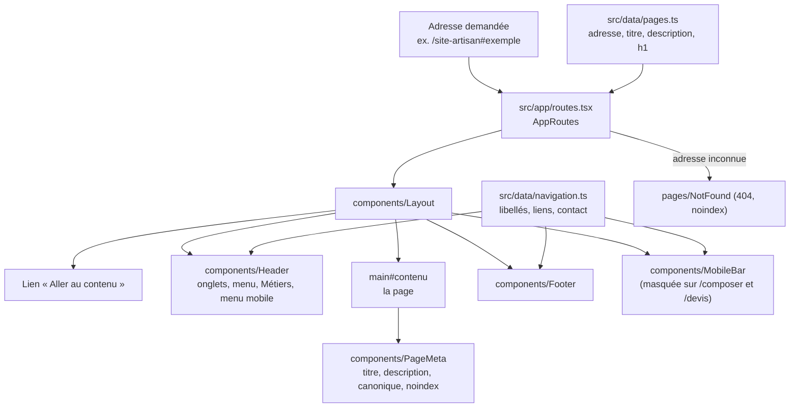

# Navigation et mise en page

## À quoi ça sert
Donner à chaque page son adresse, son titre et sa description, et entourer toutes les pages de la même mise en page : lien d'évitement, en-tête, contenu, pied de page, barre « Estimer » sur mobile.

## Schéma

## Chemin
1. `AppRoutes` (`src/app/routes.tsx`) crée une route par entrée de `pages` et affiche le composant prévu dans `builtPages`.
2. `Layout` (`src/components/Layout/Layout.tsx`) : à chaque changement d'adresse, défile vers l'ancre (`#…`) si elle existe, sinon en haut.
3. `Header` (`src/components/Header/`) : l'onglet « Informatique sur place » est actif sur les adresses qui commencent par `/informatique`, sinon « Sites & applis ». Les menus se ferment à l'Échap, au clic en dehors et au changement de page.
4. Chaque page appelle `PageMeta` pour son titre d'onglet (« Titre – Baptiste Sandoz ») et sa description.

## Comment l'appeler
- Ajouter une page : une entrée dans `src/data/pages.ts`, un dossier dans `src/pages/`, une ligne dans `builtPages`.
- Ajouter un lien de menu : `header.links` dans `src/data/navigation.ts`.
- Afficher le téléphone : renseigner `contact.phone` dans `src/data/navigation.ts`.

## Réutilisable ?
- Les blocs `Button` et `Container` : oui, tels quels.
- `Header`, `Footer`, `MobileBar`, `Layout` : propres à ce site (ils lisent `data/navigation.ts`), mais leur structure se recopie facilement.

## Tests
- **fonctionnels** : `src/app/routes.test.tsx` (chaque adresse, 404), `Header.test.tsx` (menu mobile, Échap, clic en dehors, onglet actif), `Layout.test.tsx` (lien d'évitement, ancre), `Footer.test.tsx`, `MobileBar.test.tsx`.
- **unitaires** : `PageMeta.test.tsx`.

## Fichiers
`src/data/pages.ts` · `src/data/navigation.ts` · `src/app/routes.tsx` · `src/components/{Layout,Header,Footer,MobileBar,PageMeta}/`
