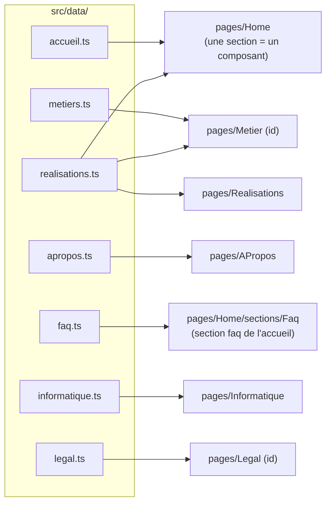
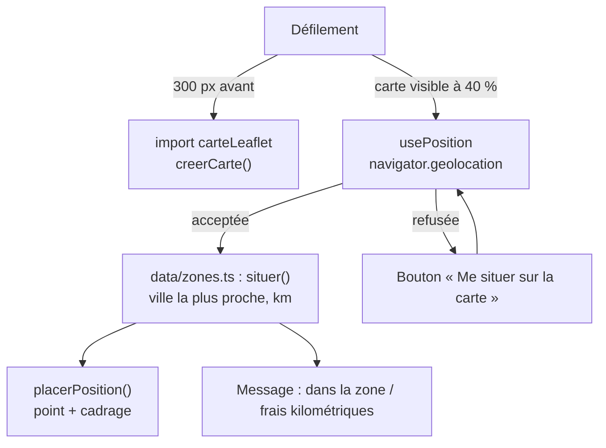
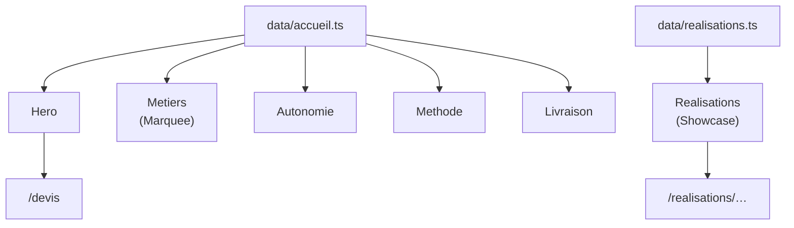

# Pages de contenu

## À quoi ça sert
Présenter l'offre et rassurer : accueil, quatre pages métier, réalisations, à propos, FAQ, informatique sur place, pages légales.

## Schéma

## Comment l'appeler
| Page | Adresse | Composant | Contenus |
| --- | --- | --- | --- |
| Accueil | `/` | `pages/Home` (sections dans `sections/`) | `data/accueil.ts` |
| Métiers | `/site-artisan`, `/site-ecommerce`, `/site-restaurant`, `/site-independant` | `<Metier id="artisan" />` | `data/metiers.ts` |
| Réalisations | `/realisations#<id>` | `pages/Realisations` | `data/realisations.ts` |
| À propos | `/a-propos` | `pages/APropos` | `data/apropos.ts` |
| FAQ | `/#faq` (l'ancienne adresse `/faq` y redirige) | `pages/Home/sections/Faq` (bloc `Accordion`) | `data/faq.ts` (`questionsFaq`, `faqAccueil`) |
| Informatique | `/informatique` | `pages/Informatique` | `data/informatique.ts` |
| Légal | `/mentions-legales`, `/cgv`, `/confidentialite` | `<Legal id="cgv" />` | `data/legal.ts` |

## Règles de contenu
- Rien d'inventé : avis, chiffres, résultats, parcours, captures restent en `[à compléter]`.
- Les prix et délais affichés (FAQ, CGV, métiers) sont lus dans `data/offres.ts`.

## Réutilisable ?
Les pages sont propres au site ; les blocs utilisés (`Card`, `SectionTitle`, `Reveal`, `Accordion`, `RotatingWords`, `Marquee`…) sont réutilisables, et `pages/Metier` / `pages/Legal` sont déjà des gabarits paramétrés.

## Tests
- **fonctionnels** : `Home.test.tsx`, `Metier.test.tsx`, `Realisations.test.tsx`, `APropos.test.tsx`, `Informatique.test.tsx`, `Legal.test.tsx`.

## Réalisations
`/realisations` liste les projets en cartes (`components/RealisationCard`, couverture = première capture). Chaque carte mène à `/realisations/<projet>` (`pages/Realisation`), qui n'affiche que ce projet. Données : `data/realisations.ts` (captures WebP dans `src/assets/realisations/`), identifiants pour le plan du site : `data/realisationsIds.ts`. Projets : Christophe Poix Moto, démo detailing, O'RDV, Alterno.

## FAQ sur l'accueil
La FAQ est une section de l'accueil, juste avant la carte des zones (`id="faq"`). La fin de l'accueil est : Questions fréquentes → Carte → Formulaire de contact, pour que la page se termine par l'action ; le pied de page n'y répète pas son appel « Un projet en tête ? ». Elle montre 3 questions, puis 3 de plus à chaque clic sur « Voir plus de questions (n restantes) ». Après chaque clic, le focus clavier passe à la première nouvelle question. Le lien « Questions fréquentes » du pied de page mène à `/#faq` (`lienFaq`). L'ancienne adresse `/faq` y redirige, ce qui garde valables les liens déjà partagés. Elle est retirée du plan du site. Les données structurées FAQPage sont maintenant sur l'accueil. Le nombre de questions par paquet se règle dans `faqAccueil.parPaquet`.

Tests : dans `Home.test.tsx` (« Questions fréquentes ») :
- place de la section et ancre ;
- 3 questions, puis 3 de plus, et le focus ;
- réponse dépliée ;
- redirection de `/faq`.

## Carte des zones et position
**Ce que montre la carte.** La section « Je me déplace chez vous » (`components/CarteZones`) trace des cercles de 50 km sans frais autour d'Amiens et d'Abbeville (`data/zones.ts`). On peut choisir une ville : la carte zoome dessus. Leaflet et les tuiles OpenStreetMap se chargent quand on approche de la carte, sauf si les services tiers ont été refusés (voir [navigation.md](navigation.md)).

**Quand la position est demandée.** `usePosition` la demande une seule fois, quand la carte est visible à 40 %. Jamais au chargement de la page.

**Ce qui s'affiche ensuite.**
- **Position donnée** :
  - `situer()` trouve la ville la plus proche ;
  - `placerPosition()` pose le point « Vous êtes ici » et cadre la carte sur ce point et sur la zone ;
  - le message dit « dans ma zone, à 15 km d'Amiens » ou, hors zone, donne le montant des frais kilométriques (dus même si le projet ne se fait pas).
- **Position refusée** :
  - la carte reste normale, avec un bouton discret « Me situer sur la carte » ;
  - si le navigateur bloque encore après une nouvelle demande, une phrase explique comment réautoriser la position.
- **Navigateur sans géolocalisation** : pas de bouton.

**Vie privée.** La position ne quitte jamais le navigateur.

**Code partagé.** La distance (`data/distance.ts`, formule de haversine) est commune avec la page Rendez-vous.

Tests : `CarteZones.test.tsx` (géolocalisation et observateurs simulés) :
- la position est demandée seulement à l'apparition de la carte ;
- dans la zone et hors zone ;
- refus, nouvelle demande, puis navigateur qui bloque ;
- pas de géolocalisation ;
- élision « d'Amiens / de Beauvais ».

## Frais kilométriques
Ils sont calculés dans `data/zones.ts`, par les mêmes fonctions pour la carte, la page Rendez-vous et les CGV :
- `kmFactures(km)` : les kilomètres au-delà de 50, comptés depuis la base la plus proche (Amiens ou Abbeville, à vol d'oiseau), **aller et retour**. Exemple : 100 km de distance donnent 50 km en plus, soit 100 km facturés ;
- `fraisKilometriques(km)` : `kmFactures × COUT_KM`, arrondi au centime ;
- `COUT_KM` : `PRIX_GAZOLE_LITRE` (2,50 €) × `CONSOMMATION_L_100KM` (7,5) / 100, soit 0,1875 € par km.
- `detailCalcul(km)` et `origineCoutKm()` : le calcul en clair, affiché en petit sous le message de la carte et de la page Rendez-vous.

Ces frais restent dus même si aucun devis n'est accepté après le déplacement (CGV, section « Déplacements »).

La page Rendez-vous accepte donc toute adresse trouvée :
- dans la zone, elle annonce « je me déplace gratuitement » ;
- au-delà, elle annonce les km facturés et le montant.

## Photo en rideau
`components/Rideau` entoure la photo de Baptiste sur la page À propos. La première fois que la photo est visible à 35 %, il ajoute `anim-rideau--ouvert` : deux panneaux aux couleurs du site s'écartent vers les côtés en 1 s, et la photo se pose avec un léger zoom. L'effet n'a lieu qu'une fois. Si l'animation est réduite, il n'y a pas de panneaux ; sans IntersectionObserver, la photo est visible tout de suite. Tests : `Rideau.test.tsx`.

## Parcours de la page À propos
Texte dans `aPropos.parcours.paragraphes` (`data/apropos.ts`), un paragraphe par entrée, tiré du portfolio. Ce qui vise un recruteur (recherche d'alternance) n'y figure pas. Tests : `APropos.test.tsx`.

## Accueil : un site que le client modifie lui-même
L'accueil s'appuie sur une idée : une fois livré, le site appartient au client et il le modifie sans coder (édition par bloc, voir `back-office.md`). Les textes ne promettent que ce qui marche : textes, photos et prix. Ajouter une page ou changer le menu reste du ressort de Baptiste, et la page le dit.

Sections, dans l'ordre (`pages/Home/Home.tsx`, données dans `data/accueil.ts`) :
1. `Hero` : promesse, prix de départ d'un site, « Demander un devis », réalisations, rendez-vous.
2. `Metiers` (`metiers`) : question, puis une bande `Marquee` de métiers.
3. `Autonomie` (`autonomie`) : ce que le client change seul.
4. `Realisations` (`realisationsSection`) : les projets de `data/realisations.ts` dans le bloc `Showcase`, sur toute la largeur.
5. `Methode` (`methode`), puis `Livraison` (`livraison`).
6. FAQ, carte des zones, contact rapide.

Chaque section est un bloc modifiable (`accueil.metiers`, `accueil.autonomie`, `accueil.livraison`…).

Tests : `Home.test.tsx` (ordre des sections, bande, autonomie, vitrine sans doublon lu, livraison) et `Showcase.test.tsx`.

## Prix unique (2026-11-07)
- **Haut de l'accueil** : « Sites à partir de 390 €. Le prix exact dans votre devis, sous 24 h. »
- **FAQ** : plus aucun montant. Délais en mots, et textes ou logo « indiqués dans le devis ».
- **Pages métier** : les fonctions sans leur prix.
- **Pourquoi moi** : « Un devis clair » remplace « Des prix affichés ».

Parcours de la page À propos, mis à jour le 2026-11-07 : trois saisons en snack-bar et huit mois chez McDonald’s, en parallèle des études.

## Exemples d'outils dans la vitrine (2026-11-07)
`data/exemples.ts` (`exemplesOutils`) : quatre maquettes d'entreprises fictives, affichées après les réalisations dans le `Showcase` de l'accueil :
- stocks et DLC ;
- carte par QR code ;
- suivi des clients ;
- galerie de photographe.

Chacune utilise `RealisationCard` avec `exemple: true`, qui ajoute le badge « Exemple » sur l'image (et « Exemple · » lu par les lecteurs d'écran). Leur lien mène au devis. Les images sont dans `assets/exemples/`, en 1 280 × 720 WebP. Leur source est `docs/exemples/maquettes-outils.html` : ouvrir le fichier dans Chrome, capturer chaque `section` en 1 280 × 720 avec une fenêtre assez haute, puis convertir en WebP. Elles ne sont jamais présentées comme des clients. Tests : `Home.test.tsx`.

## Réalisation « Perfect Clean » (2026-11-16)
La fiche `demo-detailing` (`data/realisations.ts`) est complète : six captures (`assets/realisations/demo-detailing/`, 1 280 × 720 WebP) et le lien vers https://demo.bsandoz.fr. Ses textes viennent de la documentation du projet `bsandoz-booking`. Les captures ont été prises sur la démo servie en local, car la protection d'o2switch bloque les captures automatiques du site en ligne (erreur 429). Plus aucune réalisation n'a de « [à compléter] » : l'aperçu provisoire des cartes reste testé avec une réalisation fictive (`RealisationCard.test.tsx`).
