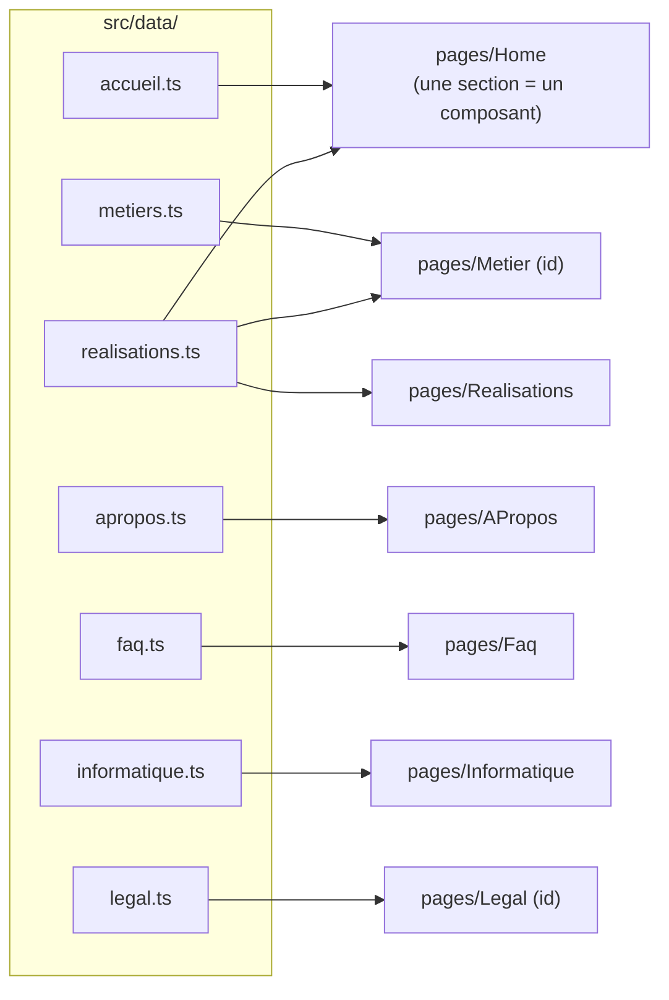

# Pages de contenu

## À quoi ça sert
Présenter l'offre et rassurer : accueil, quatre pages métier, réalisations, à propos, FAQ, informatique sur place, pages légales.

## Schéma

## Comment l'appeler
| Page | Adresse | Composant | Contenus |
| --- | --- | --- | --- |
| Accueil | `/` | `pages/Home` (sections dans `sections/`) | `data/accueil.ts` |
| Métiers | `/site-artisan`, `/site-ecommerce`, `/site-restaurant`, `/site-independant` | `<Metier id="artisan" />` | `data/metiers.ts` |
| Réalisations | `/realisations#<id>` | `pages/Realisations` | `data/realisations.ts` |
| À propos | `/a-propos` | `pages/APropos` | `data/apropos.ts` |
| FAQ | `/faq#<question>` | `pages/Faq` (bloc `Accordion`) | `data/faq.ts` |
| Informatique | `/informatique` | `pages/Informatique` | `data/informatique.ts` |
| Légal | `/mentions-legales`, `/cgv`, `/confidentialite` | `<Legal id="cgv" />` | `data/legal.ts` |

## Règles de contenu
- Rien d'inventé : avis, chiffres, résultats, parcours, captures restent en `[à compléter]`.
- Les prix et délais affichés (FAQ, CGV, métiers) sont lus dans `data/offres.ts`.

## Réutilisable ?
Les pages sont propres au site ; les blocs utilisés (`Card`, `SectionTitle`, `Reveal`, `Accordion`, `RotatingWords`, `Marquee`…) sont réutilisables, et `pages/Metier` / `pages/Legal` sont déjà des gabarits paramétrés.

## Tests
- **fonctionnels** : `Home.test.tsx`, `Metier.test.tsx`, `Realisations.test.tsx`, `APropos.test.tsx`, `Faq.test.tsx`, `Informatique.test.tsx`, `Legal.test.tsx`.

## Réalisations
`/realisations` liste les projets en cartes (`components/RealisationCard`, couverture = première capture). Chaque carte mène à `/realisations/<projet>` (`pages/Realisation`), qui n'affiche que ce projet. Données : `data/realisations.ts` (captures WebP dans `src/assets/realisations/`), identifiants pour le plan du site : `data/realisationsIds.ts`.
