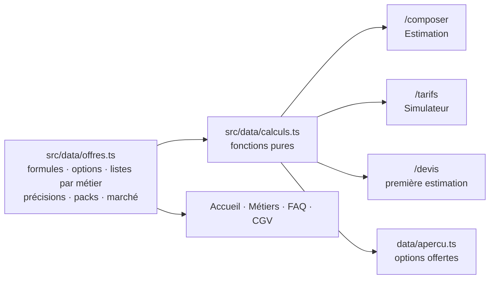
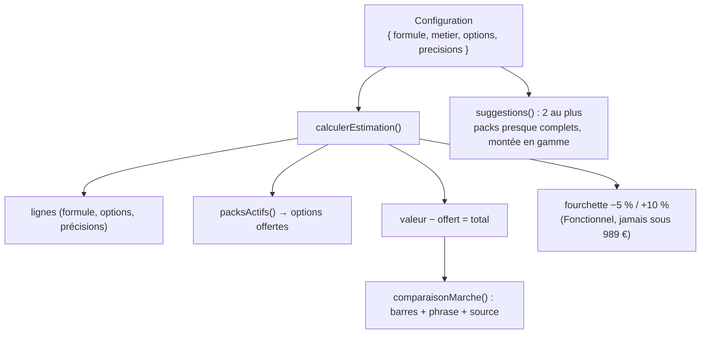

# Prix et calculs

## À quoi ça sert
Une **source unique** pour tous les prix (formules, options, packs, marché) et des **fonctions pures** qui calculent l'estimation. L'accueil, Tarifs, le configurateur, les pages métier, la FAQ, les CGV et le devis lisent tous la même chose : changer un prix à un endroit le change partout.

## Schéma




## Comment l'appeler
```ts
import { calculerEstimation, suggestions, comparaisonMarche, optionsDisponibles } from '../data/calculs';

const config = { formule: 'fonctionnel', metier: 'artisan', options: ['rdv', 'acompte'], precisions: {} };
const estimation = calculerEstimation(config);   // { lignes, valeur, offert, total, fourchette, delai, packs }
const idees = suggestions(config);                // [{ titre, texte, libelle, action }]
const marche = comparaisonMarche('fonctionnel', config.options, estimation.total);
optionsDisponibles('fonctionnel', 'artisan');     // options proposées pour ce métier
```
Pré-devis d'une demande de devis (`src/data/predevis.ts`) :
```ts
import { preDevis, texteDuPreDevis } from '../data/predevis';

const p = preDevis({ metier: 'artisan', besoins: ['rdv'] }, configurationDuConfigurateur ?? null);
// { source: 'besoins', formule: 'fonctionnel', options: ['rdv'], fourchette: { bas: 1320, haut: 1530 }, delai, suggestions: ['acompte', …] }
texteDuPreDevis(p); // bloc de texte brut pour l'e-mail
```
Affichage : `formatPrix(1200)` → « 1 200 € », `prixFormule(f)` → « à partir de 99 € » (les trois formules sont des prix de départ), `prixOption(o)` → « + 60 € / page ».

## Modifier un prix
Depuis le back-office (`/admin`, onglet « Prix ») : le site applique les prix modifiés à son chargement (`data/prixEnLigne.ts`). Les valeurs de `offres.ts` restent la référence. Voir [Back-office](back-office.md).

## Réutilisable ?
Oui : `calculs.ts` ne dépend d'aucun écran. Pour un autre site, il suffit de remplacer les données de `offres.ts`.

## Règles métier codées
- Option offerte déjà choisie : elle devient gratuite (le total baisse).
- Une option n'est offerte qu'une fois, même si deux packs l'offrent.
- Fourchette seulement pour le Fonctionnel, arrondie à 10 €, jamais sous le prix plancher.
- Marché : boutique choisie → e-commerce, sinon sur mesure ; la source est toujours affichée.
- Pré-devis : la configuration du configurateur l'emporte ; sinon, les besoins cochés donnent la formule (rendez-vous, prix, devis, appli ou vente → Fonctionnel ; réalisations, Google ou contact → Vitrine+ ; sinon aucune) et les options (adaptées au métier : un restaurant « réserve » des tables). 3 options suggérées au plus, celles qui complètent un pack d'abord.

## Tests
- **unitaires** : `src/data/calculs.test.ts` (options, packs, estimation, fourchette, suggestions, marché), `src/data/offres.test.ts` (formatage, cohérence : chaque option citée existe, chaque pack est proposable), `src/data/predevis.test.ts` (formule déduite des besoins, options par métier, suggestions, texte de l'e-mail).

## Modifier
Un prix, une option, un pack : `src/data/offres.ts`, puis relancer les tests (ils vérifient la cohérence).

## Compléments et référencement seul
- **`complements()`** (`data/offres.ts`) : deux compléments, affichés par `components/Complements` en cadres pointillés, prix à droite, sous les formules de l'accueil et de la page Tarifs :
  - la page supplémentaire (option `page`, modifiable dans le back-office) ;
  - le suivi mensuel (maintenance et mises à jour), `abonnementMensuel` à 29 € par mois, avec le tarif horaire `tarifHoraire` (29 €) en détail.
- **`offreSeo()`** : le référencement Google seul, mis en avant à part par `components/OffreSeo`. C'est un encart sombre avec un halo rose, un badge « − 20 % sur le prix du marché », le prix (`prixSeoSeul()`, soit le bas de `marche.seo` moins `REMISE_SEO`), la fourchette du marché barrée, sa source et un bouton vers le devis.

## Options incluses (2026-11-07)
Les packs sont supprimés. Chaque formule inclut des petites options (`inclusParFormule` : Vitrine 1, Vitrine+ 2, Fonctionnel 3). Les gros modules (`gros: true`) restent toujours payants. `optionsIncluses(config)` retient les premières petites options cochées, et `inclusRestantes(config)` dit combien il en reste. `calculerEstimation` compte les options incluses dans `valeur` et `offert`, pas dans `total` ; les lignes portent `offerte: true` (affichées « Inclus »). Toutes les petites options (`petitesOptions`) sont proposées avec chaque formule. Le pré-devis ne part plus que d'une estimation validée (`preDevis(config)`). Les paragraphes plus haut qui parlent de packs ou de besoins cochés sont dépassés.

## Un seul prix affiché (2026-11-07)
Le site n'affiche plus que « Sites à partir de 390 € », dans le haut de l'accueil. Le montant vient de `prixDepart()` (`data/offres.ts`, prix de la Vitrine+) et se modifie dans le bloc « Haut de page », avec le bouton « Modifier », ou dans le back-office. Les pages Tarifs et Estimation, les compléments, l'offre SEO seule, le pré-devis et les prix des pages métier et de la FAQ sont retirés. Les formules, options et calculs restent pour le back-office et l'aperçu des pages métier. Les CGV gardent le tarif horaire, car c'est un engagement contractuel.
