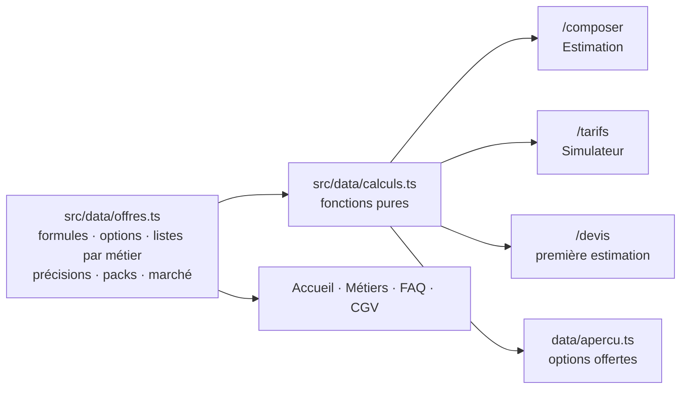
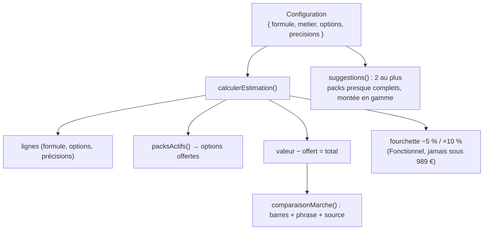

# Prix et calculs

## À quoi ça sert
Une **source unique** pour tous les prix (formules, options, packs, marché) et des **fonctions pures** qui calculent l'estimation. L'accueil, Tarifs, le configurateur, les pages métier, la FAQ, les CGV et le devis lisent tous la même chose : changer un prix à un endroit le change partout.

## Schéma




## Comment l'appeler
```ts
import { calculerEstimation, suggestions, comparaisonMarche, optionsDisponibles } from '../data/calculs';

const config = { formule: 'fonctionnel', metier: 'artisan', options: ['rdv', 'acompte'], precisions: {} };
const estimation = calculerEstimation(config);   // { lignes, valeur, offert, total, fourchette, delai, packs }
const idees = suggestions(config);                // [{ titre, texte, libelle, action }]
const marche = comparaisonMarche('fonctionnel', config.options, estimation.total);
optionsDisponibles('fonctionnel', 'artisan');     // options proposées pour ce métier
```
Pré-devis d'une demande de devis (`src/data/predevis.ts`) :
```ts
import { preDevis, texteDuPreDevis } from '../data/predevis';

const p = preDevis({ metier: 'artisan', besoins: ['rdv'] }, configurationDuConfigurateur ?? null);
// { source: 'besoins', formule: 'fonctionnel', options: ['rdv'], fourchette: { bas: 1320, haut: 1530 }, delai, suggestions: ['acompte', …] }
texteDuPreDevis(p); // bloc de texte brut pour l'e-mail
```
Affichage : `formatPrix(1200)` → « 1 200 € », `prixFormule(f)` → « à partir de 99 € » (les trois formules sont des prix de départ), `prixOption(o)` → « + 60 € / page ».

## Modifier un prix
Depuis le back-office (`/admin`, onglet « Prix ») : le site applique les prix modifiés à son chargement (`data/prixEnLigne.ts`). Les valeurs de `offres.ts` restent la référence. Voir [Back-office](back-office.md).

## Réutilisable ?
Oui : `calculs.ts` ne dépend d'aucun écran. Pour un autre site, il suffit de remplacer les données de `offres.ts`.

## Règles métier codées
- Option offerte déjà choisie : elle devient gratuite (le total baisse).
- Une option n'est offerte qu'une fois, même si deux packs l'offrent.
- Fourchette seulement pour le Fonctionnel, arrondie à 10 €, jamais sous le prix plancher.
- Marché : boutique choisie → e-commerce, sinon sur mesure ; la source est toujours affichée.
- Pré-devis : la configuration du configurateur l'emporte ; sinon, les besoins cochés donnent la formule (rendez-vous, prix, devis, appli ou vente → Fonctionnel ; réalisations, Google ou contact → Vitrine+ ; sinon aucune) et les options (adaptées au métier : un restaurant « réserve » des tables). 3 options suggérées au plus, celles qui complètent un pack d'abord.

## Tests
- **unitaires** : `src/data/calculs.test.ts` (options, packs, estimation, fourchette, suggestions, marché), `src/data/offres.test.ts` (formatage, cohérence : chaque option citée existe, chaque pack est proposable), `src/data/predevis.test.ts` (formule déduite des besoins, options par métier, suggestions, texte de l'e-mail).

## Modifier
Un prix, une option, un pack : `src/data/offres.ts`, puis relancer les tests (ils vérifient la cohérence).

## Compléments
`complements()` (`data/offres.ts`) liste ce qui s'ajoute aux formules. Le composant `components/Complements` les affiche à part, sous les trois formules (accueil et Tarifs) :
- **page supplémentaire** : prix de l'option `page`, modifiable dans le back-office ;
- **suivi mensuel** : `abonnementMensuel`, 29 € par mois (hébergement et maintenance) ;
- **intervention à l'heure** : `tarifHoraire`, 29 € de l'heure ;
- **référencement Google seul** : `prixSeoSeul()`, soit le bas de la fourchette `marche.seo` moins `REMISE_SEO` (20 %), 400 €. La source est affichée.

La liste est calculée à chaque affichage, donc elle suit les prix du back-office.
