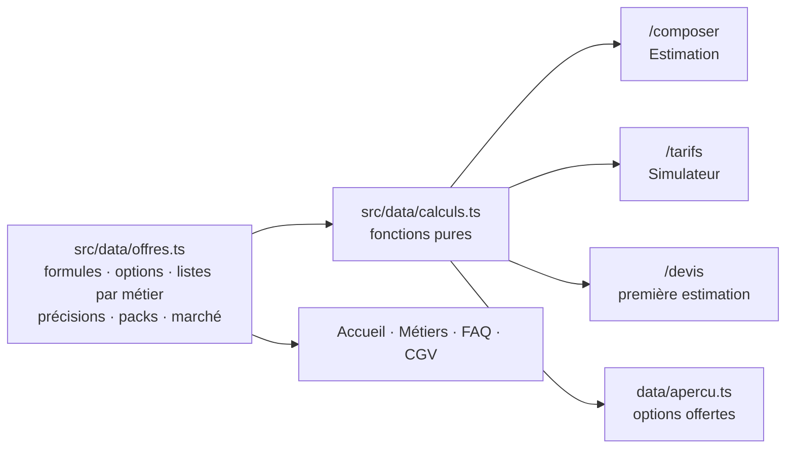
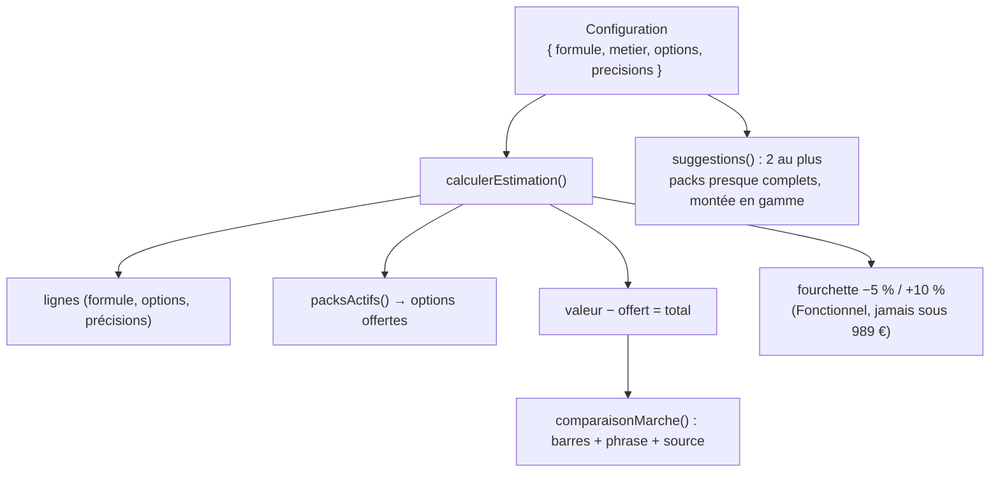

# Prix et calculs

## À quoi ça sert
Une **source unique** pour tous les prix (formules, options, packs, marché) et des **fonctions pures** qui calculent l'estimation. L'accueil, Tarifs, le configurateur, les pages métier, la FAQ, les CGV et le devis lisent tous la même chose : changer un prix à un endroit le change partout.

## Schéma




## Comment l'appeler
```ts
import { calculerEstimation, suggestions, comparaisonMarche, optionsDisponibles } from '../data/calculs';

const config = { formule: 'fonctionnel', metier: 'artisan', options: ['rdv', 'acompte'], precisions: {} };
const estimation = calculerEstimation(config);   // { lignes, valeur, offert, total, fourchette, delai, packs }
const idees = suggestions(config);                // [{ titre, texte, libelle, action }]
const marche = comparaisonMarche('fonctionnel', config.options, estimation.total);
optionsDisponibles('fonctionnel', 'artisan');     // options proposées pour ce métier
```
Affichage : `formatPrix(1200)` → « 1 200 € », `prixFormule(f)` → « dès 989 € », `prixOption(o)` → « + 60 € / page ».

## Réutilisable ?
Oui : `calculs.ts` ne dépend d'aucun écran. Pour un autre site, il suffit de remplacer les données de `offres.ts`.

## Règles métier codées
- Option offerte déjà choisie : elle devient gratuite (le total baisse).
- Une option n'est offerte qu'une fois, même si deux packs l'offrent.
- Fourchette seulement pour le Fonctionnel, arrondie à 10 €, jamais sous le prix plancher.
- Marché : boutique choisie → e-commerce, sinon sur mesure ; la source est toujours affichée.

## Tests
- **unitaires** : `src/data/calculs.test.ts` (options, packs, estimation, fourchette, suggestions, marché), `src/data/offres.test.ts` (formatage, cohérence : chaque option citée existe, chaque pack est proposable).

## Modifier
Un prix, une option, un pack : `src/data/offres.ts`, puis relancer les tests (ils vérifient la cohérence).
