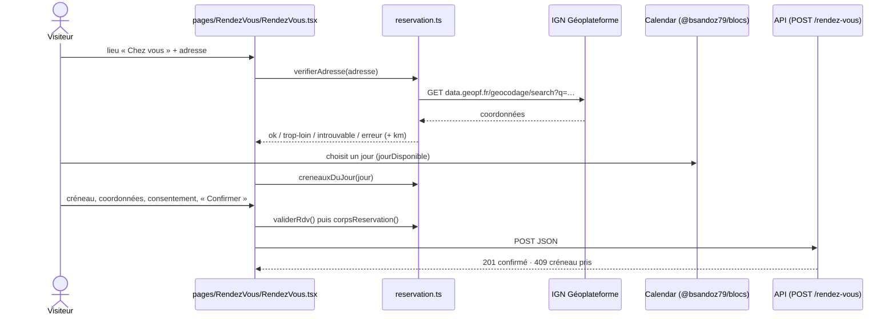

# Rendez-vous découverte

## À quoi ça sert
Réserver un rendez-vous gratuit d'une heure : chez le client (50 km autour d'Amiens), en visio ou par téléphone.

## Schéma


## Chemin
| Élément | Fichier |
| --- | --- |
| Page | `pages/RendezVous/RendezVous.tsx` |
| Jours, créneaux, distance, géocodage, validation, corps envoyé | `pages/RendezVous/reservation.ts` |
| Lieux, **disponibilités**, zone, textes | `data/rendezvous.ts` |
| Calendrier | `packages/blocs/src/Calendar/` (+ `dates.ts`) |

## Comment l'appeler
- Page : `/rendez-vous`.
- API (module Booking, voir [booking.md](booking.md)) : `POST {VITE_API_URL}/rendez-vous`, JSON `{ lieu, adresse|null, jour: "AAAA-MM-JJ", creneau: "HH:MM", nom, telephone, email, activite, message }`. `VITE_API_URL` vaut `https://api.bsandoz.fr` par défaut.
- Calendrier dans une autre page :
```tsx
<Calendar label="Date" month={mois} onMonthChange={setMois} value={jour} onChange={setJour}
  isDisabled={(d) => jourDeLaSemaine(d) >= 5} min={aujourdhui()} today={aujourdhui()} />
```

## Dans l'espace client
La personne connectée retrouve ses rendez-vous (par son adresse e-mail) dans `/mon-espace` : `front/src/pages/MonEspace/MesRendezVous.tsx` → `GET /espace/rendez-vous`. Elle peut ajouter un rendez-vous à son agenda (`.ics`), le déplacer (nouveau créneau, puis annulation) ou l'annuler (`POST /espace/rendez-vous/{id}/annuler`, même cas d'usage que le lien du mail). Côté API : `api/src/Liaisons/EspaceRendezVousController.php`.

## Règles
- Réservable : de demain à 60 jours, jours travaillés seulement (**à confirmer**, dans `disponibilites`).
- Créneaux d'une heure espacés de 30 minutes pour le trajet.
- Distance à vol d'oiseau depuis Amiens ; au-delà de 50 km, visio ou téléphone.
- Si le géocodage ne répond pas, la réservation reste possible (vérification manuelle).

## Réutilisable ?
- `Calendar` : **oui** (prévu pour le kit de réservation des clients).
- `distanceKm`, `verifierAdresse` : oui, en changeant la zone.

## Tests
- **unitaires** : `Calendar.test.tsx` (grille, jours indisponibles, clavier, bornes), `dates.test.ts`, `reservation.test.ts` (jours, créneaux, distance Amiens–Abbeville, géocodage simulé dans/hors zone/introuvable/panne, validation).
- **fonctionnels** : `RendezVous.test.tsx` (date fixée, réseau simulé : adresse, jours, créneaux, confirmation, créneau pris).
