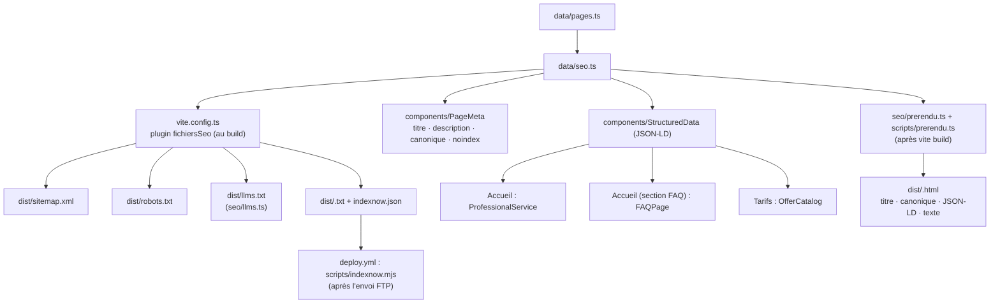

# SEO

## À quoi ça sert
Être bien compris par Google et par les assistants IA (ChatGPT, Claude, Perplexity…) : titre et description par page, adresse canonique, pages provisoires non indexées, sitemap, robots.txt, llms.txt, IndexNow et données structurées.

## Schéma


## Résumé pour les assistants IA (llms.txt)
`seo/llms.ts` écrit `dist/llms.txt` au build (format llmstxt.org, en Markdown) : qui je suis, coordonnées, formules et prix de départ, informatique sur place, pages par métier, réalisations, questions fréquentes, pages utiles. Tout vient des données du site. Le `.htaccess` sert les `.txt` en UTF-8. Les robots des IA (GPTBot, ClaudeBot, PerplexityBot) lisent bien les pages : vérifié le 23/11/2026 (code 200, texte complet).

## IndexNow (Bing)
À chaque mise en ligne, le déploiement annonce toutes les pages du sitemap à IndexNow (`api.indexnow.org`, partagé par Bing, Yandex, Seznam…) : Bing les relit sans attendre, et ChatGPT et Copilot, qui cherchent avec Bing, les voient plus vite.
- Clé publique `INDEXNOW_CLE` (`data/seo.ts`), servie dans `/<clé>.txt` (généré au build).
- `indexnow.json` (liste des pages, `requeteIndexNow()`) est généré au build mais jamais envoyé sur le serveur.
- `front/scripts/indexnow.mjs` envoie la liste après le FTP ; une réponse autre que 200/202 donne un avertissement, jamais un échec du déploiement.
- Suivi : Bing Webmaster Tools → IndexNow.

## Pages lisibles sans JavaScript
Après `vite build`, `scripts/prerendu.ts` (construit avec `vite build --ssr`, lancé par node) écrit une page HTML par page publique : `dist/a-propos.html`, `dist/realisations/ordv.html`… Chaque page a son titre, sa description, sa canonique, son fil d'Ariane et son texte principal. Le `.htaccess` sert `/a-propos` depuis `a-propos.html`. React remplace ce contenu au chargement.

Ce texte est placé dans `<div data-statique>`. Le petit script du `<head>` (`index.html`) pose la classe `js` sur `<html>`, et `base.css` cache alors ce bloc (`.js [data-statique] { display: none }`) : les visiteurs ne voient jamais la page sans mise en forme avant React. Les robots qui lisent le HTML et les navigateurs sans JavaScript, eux, lisent le texte.

## Comment l'appeler
```tsx
<PageMeta title={page.title} description={page.description} />          // page normale
<PageMeta title="Page introuvable" description="…" noindex />             // 404
<StructuredData data={jsonLdFaq(questionsFaq)} />
```
- Exclure une page du sitemap : l'ajouter à `pagesNonIndexees` (`data/seo.ts`).
- Adresse du site : `site.url` (`data/pages.ts`).

## Réutilisable ?
Oui : `genererSitemap`, `robotsTxt`, `jsonLd*` sont des fonctions pures ; `StructuredData` et `PageMeta` fonctionnent sur n'importe quel site React.

## Tests
- **unitaires** : `data/seo.test.ts` (sitemap XML valide, robots, données structurées sans adresse ni note inventées), `StructuredData.test.tsx` (échappement de `<`), `PageMeta.test.tsx` (canonique, noindex), `data/seo.test.ts` (requête IndexNow), `seo/llms.test.ts` (format, coordonnées, formules, réalisations, rien de l'espace client).
- **fonctionnels** : `app/seo.test.tsx` (bonnes données structurées sur chaque page, noindex de la 404).

## Reste ouvert
`noindex` pour `preview.bsandoz.fr` ; fiche Google Business Profile.
