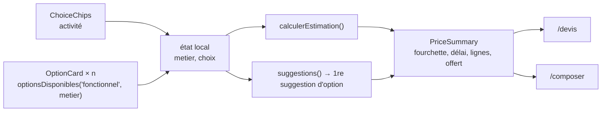

# Simulateur de la page Tarifs

## À quoi ça sert
Sur `/tarifs`, simuler rapidement un site **fonctionnel** : activité + fonctions → prix en direct, packs offerts et une suggestion. Le configurateur complet reste `/composer`.

## Schéma

## Chemin
`pages/Tarifs/Tarifs.tsx` (formules, encadré, après mise en ligne) → `pages/Tarifs/Simulateur.tsx` (état local, sans mémoire) → `data/calculs.ts`. Textes : `data/tarifs.ts`.

## Comment l'appeler
Page `/tarifs`. Le composant `Simulateur` n'a pas de paramètre.

## Réutilisable ?
Non (propre à la page), mais il n'assemble que des blocs réutilisables et les calculs communs.

## Tests
- **fonctionnels** : `pages/Tarifs/Tarifs.test.tsx` (activité demandée d'abord, prix en direct, pack proposé puis offert, options gardées au changement d'activité, liens).
