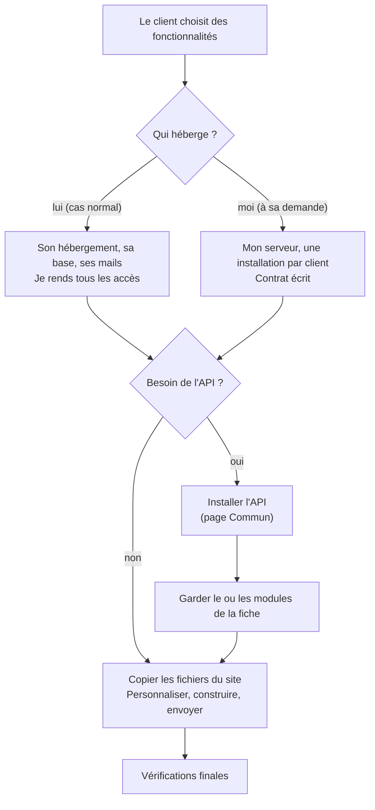

# Mise en place sur le site d'un client

Comment installer une fonctionnalité sur le site d'un client, sur un autre domaine. Une fiche par fonctionnalité, et une page [commune](commun.md) pour ce qui se répète.

## Deux façons de livrer
Toujours le dire au client **avant** de commencer, et l'écrire dans le devis.

| | **Client autonome** (cas normal) | **Je gère pour lui** (s'il le demande) |
| --- | --- | --- |
| Hébergement | le sien | le mien |
| Domaine | le sien | le sien (il le pointe vers mon serveur) |
| Base de données | la sienne | une base par client, sur mon serveur |
| Boîte mail d'envoi | la sienne | sur son domaine |
| Mots de passe et secrets | chez lui | chez moi |
| Après la livraison | je ne garde aucun accès | je fais les mises à jour et les sauvegardes |
| Si je m'arrête | rien ne change pour lui | **son site s'arrête s'il n'est pas transféré** |
| Prix de la gestion | sans objet | [à compléter] |

Dans les deux cas, le code est copié pour **ce** client : pas de paquet privé à installer, pas d'appel à `bsandoz.fr`.

### Si je gère pour lui
- **Une installation par client** : sa copie de l'API, sa base, son `.env.local`, son `APP_SECRET`. L'API ne sait pas séparer plusieurs clients : avec une base commune, leurs rendez-vous et leurs comptes seraient mélangés.
- **Le site et l'API partagent son domaine** (`client.fr` et `api.client.fr`). Avec `api.bsandoz.fr`, la connexion à l'espace client ne marche pas : voir [Le domaine](commun.md#le-domaine).
- **Cloisonnement** : deux clients sur le même compte d'hébergement peuvent, en cas de faille chez l'un, exposer les fichiers de l'autre. Des comptes séparés sont plus sûrs. [à décider]
- **Hébergeur** : vérifier que ses conditions autorisent l'hébergement pour des tiers. [à vérifier]
- **À écrire avant de démarrer**, et à faire relire par un professionnel du droit : ce que je gère et jusqu'où, le prix, le préavis, ce qui se passe si l'un de nous arrête. Je traite alors des données pour lui : il faut le contrat de sous-traitance du RGPD (article 28), et sa politique de confidentialité doit me citer. [à compléter]
- **Il garde une sortie** : à sa demande, je lui remets le code, la base et les réglages. Voir [Passer d'une façon à l'autre](commun.md#passer-dune-façon-à-lautre).

## Quelle fiche ?
| Le client veut | Fiche | API et base ? |
| --- | --- | --- |
| Des composants (calendrier, cartes, boutons…) | [Blocs](blocs.md) | non |
| Afficher ses prix, estimer un montant, être bien référencé | [Prix et référencement](prix-et-referencement.md) | non |
| Un formulaire de devis reçu par mail | [Devis par mail](devis-par-mail.md) | non (PHP seul) |
| Prendre des rendez-vous en ligne | [Rendez-vous](rendez-vous.md) | oui |
| Enregistrer et numéroter ses demandes | [Demandes de devis](demandes-de-devis.md) | oui |
| Un espace client : compte, rendez-vous, devis | [Espace client](espace-client.md) | oui |

Le configurateur et les pages de contenu sont propres à bsandoz.fr : ils ne se copient pas, on les réécrit avec les blocs.

## Ce qui a été essayé, et ce qui ne l'a pas été
Essayé le 2026-11-06, dans des conteneurs Docker :
- chaque module seul (Booking, Auth, Prospect, Catalogue), migrations et cache de production compris, sur MariaDB 10.11. Les tests qui attendent une liaison échouent, comme prévu, et les autres passent ;
- l'API complète sur MySQL 8.0 (toutes les versions) et sur MariaDB 10.11 (avant le fil de messages et le back-office) ;
- Booking seul, puis l'API complète, sous Apache en mode production, avec l'origine d'un autre domaine ;
- un site vierge construit avec les seuls fichiers listés dans les fiches (build et types) ;
- le parcours complet de bsandoz.fr dans Chrome, API en production : demande, mails, activation, cookie, fil, back-office, devis, réponse par mail relevée en IMAP, PDF, prix, disponibilités. Sur `localhost`, avec un faux serveur de mail.

**Jamais essayé** : un vrai hébergement, un vrai domaine, un vrai serveur de mail, la connexion à l'espace client sur `client.fr` et `api.client.fr`, le mode « je gère pour lui ». Le premier client servira de test : prévoir du temps.

Les tests de l'API ne se copient pas chez le client : plusieurs supposent les liaisons de bsandoz.fr. Ils restent ici ; chez lui, ce sont les vérifications finales qui comptent.
